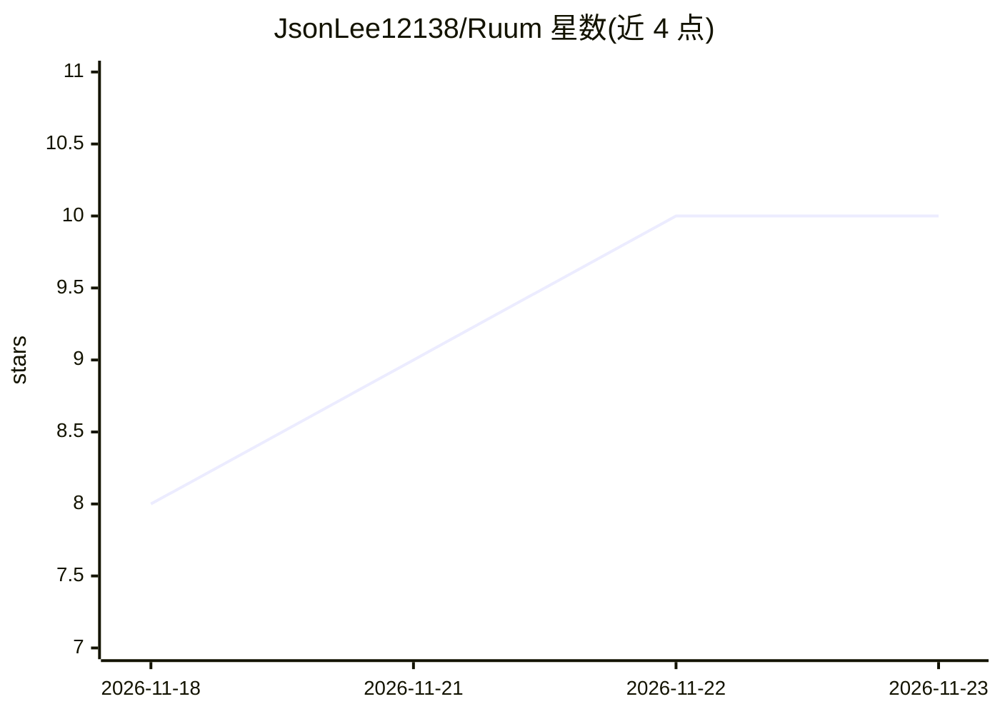

# JsonLee12138/Ruum

⭐ 10 · Rust · GPL-3.0 · 推送 2026-11-20 · [GitHub](https://github.com/JsonLee12138/Ruum) · [官网](https://ruum.jsonlee12138.com/) · 个人维护 · 中文 README

**跨平台磁盘空间分析与清理工具，含 AI 看护助手与 MCP 服务器**

基于 Rust 与 GPUI 构建的跨平台 treemap 磁盘分析器，支持 macOS、Linux 与 Windows。扫描本地磁盘与远程 SSH 服务器，以按实际占用比例缩放的嵌套矩形图展示目录结构，提供非破坏性的标记-审查-清理流程（移入回收站或确认后删除），内置磁盘剩余空间 Watchdog、AI 清理助手以及 stdio MCP 服务器（`ruum mcp`）。安装方式覆盖 Homebrew、各发行版包、AppImage、安装包及源码构建；界面自动本地化为英/中/日/韩四种语言。

## 筛选速览

| 维度 | 判定 | 备注 |
|---|---|---|
| AI 角色 | `ai-enhanced` | 去掉 AI 部分产品仍成立 |
| 许可风险 | `viral` | GPL-3.0 |
| 部署形态 | `desktop` | 安装包/桌面程序 |
| 模型依赖 | — | README 未给出锁定关系 |
| 硬件要求 | — | 无带数字的原话,不猜 |
| 安装摩擦 | `medium` | 含编译或系统依赖之一 |
| 成熟度 | — | 结构信号不足 |

## 能力要点

- 本地与 SSH 远程磁盘的 treemap 可视化扫描
- 非破坏性标记-审查-清理流程，支持回收站与确认删除
- 内置 AI 清理助手与 stdio MCP 服务器（`ruum mcp`）
- 支持 Watchdog 磁盘剩余空间监控与多语言界面

## 适用场景

- 查找并清理占满磁盘的构建产物、缓存与冗余文件
- 通过 SSH 无需传输文件即可分析远程服务器磁盘占用
- 监控磁盘剩余空间并在不足时收到提醒
- 通过 MCP 让 AI agent 调用磁盘分析与清理能力

## 场景标签

`AI 助手` · 领域:对话与助手

## 证据(README 行号)

> L9: **ruum** is a cross-platform treemap disk analyzer and cleanup companion for **macOS**, **Linux**, and **Windows**. 
> L111: This registers `/usr/local/bin/ruum` on macOS, `~/.local/bin/ruum` on Linux, or copies `ruum.exe` into `%LOCALAPPD
> L157:  - **Export instead of deleting:** press `s` (**Save list…**) to export a plain path list, or `a` (**Copy as promp

## 星数曲线

2026-11-18 8 → 2026-11-23 10（+2）

---
*卡片 v1 · prompt 1.4 · 生成 2026-11-20 · 置信度 high · 依据 README sha `805b139abc16` · [字段定义](../../DATASET.md)*
