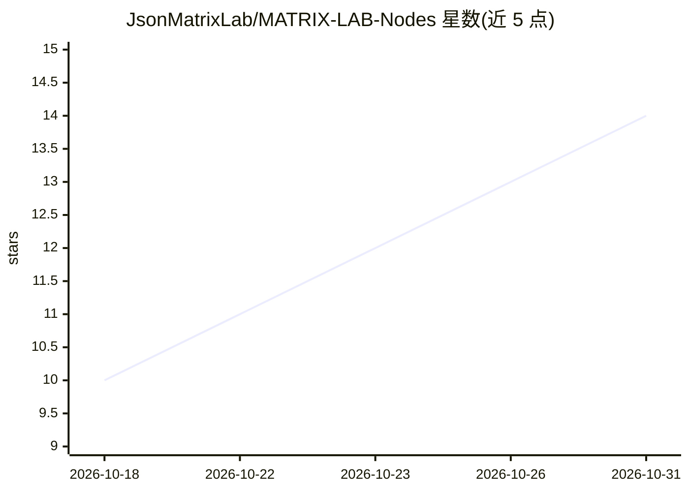

# JsonMatrixLab/MATRIX-LAB-Nodes

⭐ 14 · Python · Apache-2.0 · 推送 2026-10-29 · [GitHub](https://github.com/JsonMatrixLab/MATRIX-LAB-Nodes) · 组织维护

**ComfyUI 图像/视频生成辅助节点包（23 节点+4 别名）**

面向 ComfyUI 用户的统一自定义节点包，共 27 个注册类 ID，覆盖图像批量输入与元数据清除输出、分辨率几何选择（Krea 2/Qwen Image 2.1/FLUX 3 Klein/H3）、采样与细节处理、皮肤与眼部掩码（需自备模型权重）、Photo Finisher 确定性后期、辅助提示词，以及两个视频生成节点（WAN 3.0 经 WaveSpeed 付费 API、SCAIL-2 窗口引擎）。安装为单文件夹放入 custom_nodes，与旧拆分包互斥。当前为 0.8.0.dev0 开发版，部分兼容性验证仅限特定 ComfyUI/前端/RTX 5090 环境。

## 筛选速览

| 维度 | 判定 | 备注 |
|---|---|---|
| AI 角色 | `ai-ecosystem` | LLM/agent 周边工具 |
| 许可风险 | `permissive` | Apache-2.0 |
| 部署形态 | `None` |  |
| 模型依赖 | — | README 未给出锁定关系 |
| 硬件要求 | — | 无带数字的原话,不猜 |
| 安装摩擦 | `low` | 无编译、无系统依赖或容器化 |
| 成熟度 | `idea` | |

## 能力要点

- 23 个节点 + 4 个 Krea 2 V1 兼容别名，分 7 个 MATRIX LAB 类别
- 掩码节点不捆绑模型权重，需自备 hash 匹配资产与运行时
- WAN 3.0 节点经 WaveSpeed 提交，需用户密钥且每次生成计费
- Auto Prompter 的 Generate Prompt 需显式激活才向 xAI 发送请求

## 适用场景

- 在 ComfyUI 中搭建 Krea 2 图像生成工作流
- 生成/清除不含提示词与工作流元数据的图像和视频输出
- 选择特定模型的原生分辨率几何（Qwen Image 2.1、FLUX 3 Klein 等）
- 对生成结果做确定性局部色调/细节后期处理

## 场景标签

`图像生成` `视频生成` · 领域:内容生成

## 证据(README 行号)

> L5: Twenty-three current ComfyUI nodes for image input, resolution, sampling, masks, finishing,
> L30: - **Install it yourself:** follow INSTALL.md.
> L91: - **MATRIX WAN 3.0** — submit one of five WAN 3.0 operations to WaveSpeed and return a native ComfyUI VIDEO. Every 

## 星数曲线

2026-10-18 10 → 2026-10-31 14（+4）

---
*卡片 v1 · prompt 1.4 · 生成 2026-10-31 · 置信度 high · 依据 README sha `096f764d51f6` · [字段定义](../../DATASET.md)*
