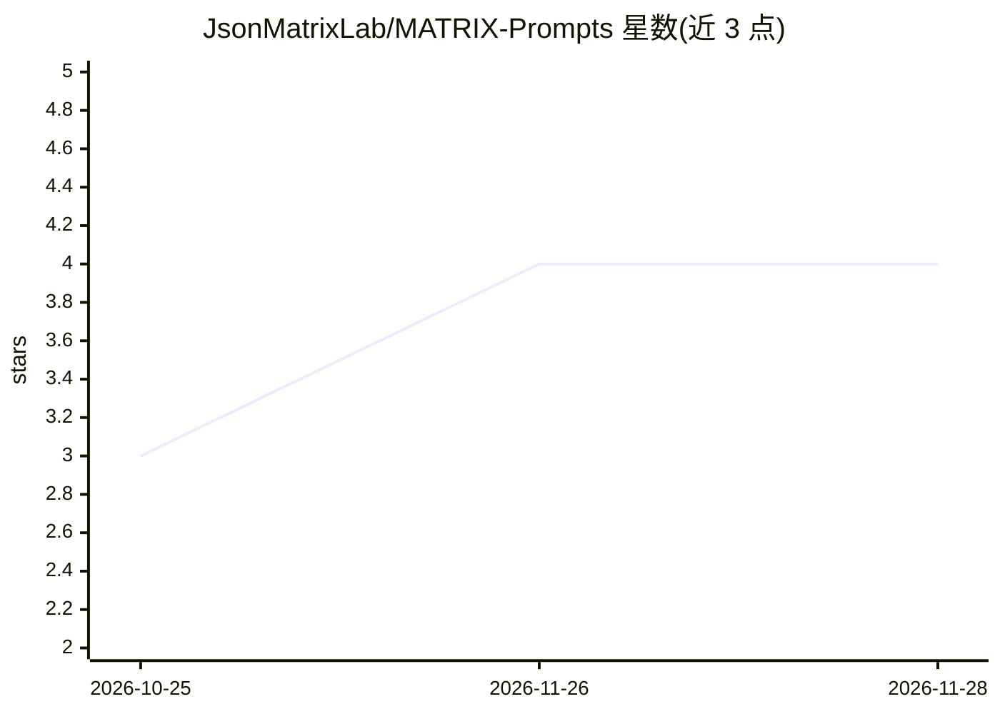

# JsonMatrixLab/MATRIX-Prompts

⭐ 4 · Apache-2.0 · 推送 2026-10-19 · [GitHub](https://github.com/JsonMatrixLab/MATRIX-Prompts) · 组织维护

**AI 网红视频提示词清单：复现 MATRIX LAB 短片**

MATRIX LAB 公开其 Instagram AI 网红短片所用提示词的清单仓库：以表格列出各短片名称、所用模型（Wan 3.0）与类型（参考图生成视频、时长、画幅），每个提示词文件内含模型设置、参考输入与完整提示文本，用户可替换角色名与场景细节生成自己的内容。另附免费 ComfyUI 数据集工作流链接，采用 Apache 2.0 许可。

## 筛选速览

| 维度 | 判定 | 备注 |
|---|---|---|
| AI 角色 | `ai-knowledge` | 知识聚合/清单类 |
| 许可风险 | `permissive` | Apache-2.0 |
| 部署形态 | `None` |  |
| 模型依赖 | — | README 未给出锁定关系 |
| 硬件要求 | — | 无带数字的原话,不猜 |
| 安装摩擦 | `low` | 无编译、无系统依赖或容器化 |
| 成熟度 | — | 结构信号不足 |

## 能力要点

- 提示词条目列出模型设置、参考输入与完整提示文本
- 覆盖 Wan 3.0 参考图生成视频（含对话型）与 16:9 规格
- 附带免费 ComfyUI 数据集工作流

## 适用场景

- 照提示词复现或改编 AI 网红风格短片
- 为自己的虚拟角色生成带对话的视频
- 获取 ComfyUI 数据集工作流辅助训练

## 场景标签

`提示工程` `视频生成` · 领域:Agent 开发

## 证据(README 行号)

> L3: The exact prompts behind MATRIX LAB's AI influencer reels, with the settings and inputs you need to reproduce them.
> L5: |Prompt|Model|Type|

## 星数曲线

2026-10-25 3 → 2026-11-28 4（+1）

---
*卡片 v1 · prompt 1.4 · 生成 2026-11-26 · 置信度 high · 依据 README sha `50456d37caf3` · [字段定义](../../DATASET.md)*
