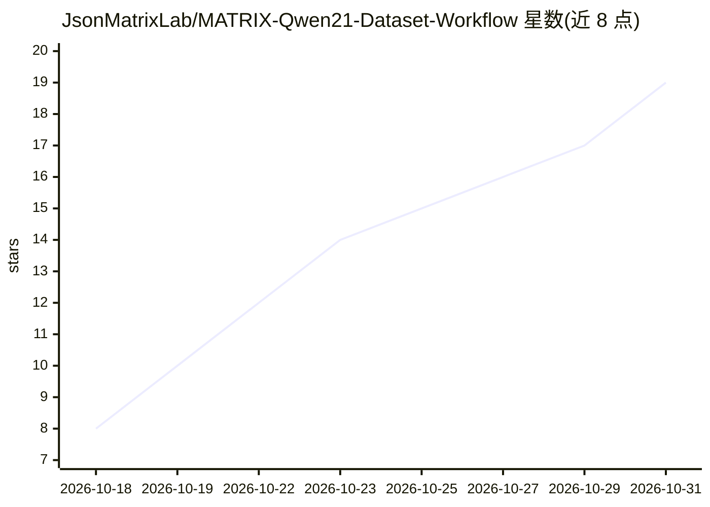

# JsonMatrixLab/MATRIX-Qwen21-Dataset-Workflow

⭐ 19 · Apache-2.0 · 推送 2026-10-14 · [GitHub](https://github.com/JsonMatrixLab/MATRIX-Qwen21-Dataset-Workflow) · 组织维护

**ComfyUI 工作流：从少量参考图生成 32 张角色数据集图片**

提供两个 ComfyUI 工作流 JSON（Normal 25 步与 Turbo 8 步）及配套安装文档，用于从约 3 张核心参考图（脸部、身体、附加视角）扩展生成四行各 8 张、约 2K 分辨率的角色数据集（表情/头部 360/上半身 360/全身 360），服务于 LoRA 训练数据准备。基于 Qwen Image 2.1 检查点（INT8），仓库不含模型权重与 ComfyUI 本体。限制：不宣称硬件广泛兼容、变体间输出一致或测得性能提升，生成结果需人工审核，Qwen 权重限非商用。

## 筛选速览

| 维度 | 判定 | 备注 |
|---|---|---|
| AI 角色 | `ai-native` | 本体是模型或模型工具 |
| 许可风险 | `permissive` | Apache-2.0 |
| 部署形态 | `None` |  |
| 模型依赖 | — | README 未给出锁定关系 |
| 硬件要求 | — | 无带数字的原话,不猜 |
| 安装摩擦 | `low` | 无编译、无系统依赖或容器化 |
| 成熟度 | `idea` | |

## 能力要点

- 3 张参考图扩展为 32 张角色数据集（4 行 × 8 图，约 2K）
- Normal（25 步 Euler）与 Turbo（8 步固定步长）双工作流
- 可选 LoRA 行默认关闭，逐行启用控制输出
- 每张卡片保存 PNG 到 dataset/ 分类子目录

## 适用场景

- 为角色 LoRA 训练准备本地多视角数据集
- 用少量参考图生成头部/上半身/全身 360 度视图
- 在 ComfyUI 中按行控制生成数量与分辨率预设

## 场景标签

`图像生成` · 领域:内容生成

## 证据(README 行号)

> L3: Build a local 32-picture character dataset in ComfyUI from a small set of reference pictures.
> L16: Three core reference pictures can define the face, body, and an extra view. The workflow expands them into four row

## 星数曲线

2026-10-18 8 → 2026-10-31 19（+11）

---
*卡片 v1 · prompt 1.4 · 生成 2026-10-30 · 置信度 high · 依据 README sha `320080550bee` · [字段定义](../../DATASET.md)*
