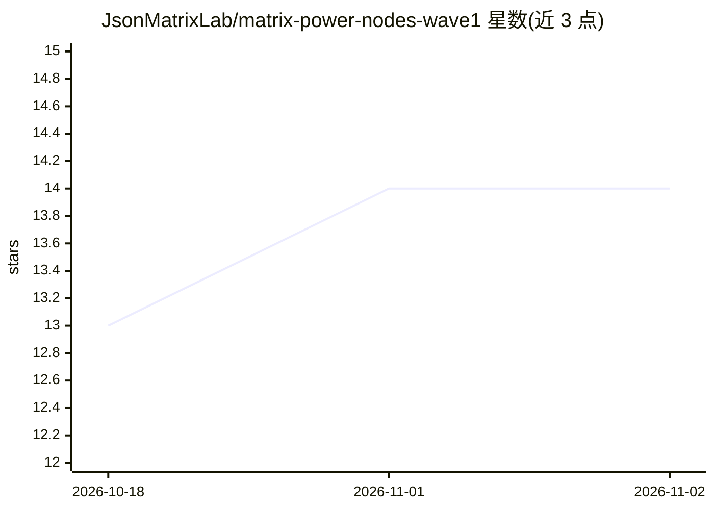

# JsonMatrixLab/matrix-power-nodes-wave1

⭐ 14 · Python · MIT · 推送 2026-08-05 · [GitHub](https://github.com/JsonMatrixLab/matrix-power-nodes-wave1) · 组织维护

**ComfyUI 的 WaveSpeed 图像生成/编辑节点包（10 个节点）**

为 ComfyUI 提供十个自定义节点，通过 WaveSpeed API 调用 GPT Image 2、Nano Banana 2/Pro、Seedream 4.5/5.0 Pro 等模型进行文生图与图像编辑。提供画布内密钥输入流程，密钥经本地凭据 ABI v2 端点存储、不进入工作流图。所有节点默认 live=false，仅在用户显式设置 live=true 并排队后才发起付费请求。安装通过 PowerShell/sh 脚本完成，不覆盖已有包、不修改 ComfyUI 本身。

## 筛选速览

| 维度 | 判定 | 备注 |
|---|---|---|
| AI 角色 | `ai-ecosystem` | LLM/agent 周边工具 |
| 许可风险 | `permissive` | MIT |
| 部署形态 | `None` |  |
| 模型依赖 | — | README 未给出锁定关系 |
| 硬件要求 | — | 无带数字的原话,不猜 |
| 安装摩擦 | `low` | 无编译、无系统依赖或容器化 |
| 成熟度 | — | 结构信号不足 |

## 能力要点

- 10 个节点覆盖文生图与图像编辑（GPT Image 2、Nano Banana 系列、Seedream 系列）
- 画布内安全密钥输入，密钥不进入工作流/prompt 图
- 默认 live=false，显式授权后才发起 provider 请求
- 安装脚本不合并、不覆盖、不修改 ComfyUI 本身

## 适用场景

- 在 ComfyUI 工作流中调用 WaveSpeed 托管的图像生成模型
- 通过显式 live 开关控制图像生成支出
- 为图像编辑流程接入多个模型选项

## 场景标签

`图像生成` · 领域:内容生成

## 证据(README 行号)

> L3: Ten production-tested ComfyUI nodes for WaveSpeed image generation and image editing. One secure
> L11: |Model|Text to Image|Edit|

## 星数曲线

2026-10-18 13 → 2026-11-02 14（+1）

---
*卡片 v1 · prompt 1.4 · 生成 2026-10-31 · 置信度 high · 依据 README sha `7971fbe03255` · [字段定义](../../DATASET.md)*
