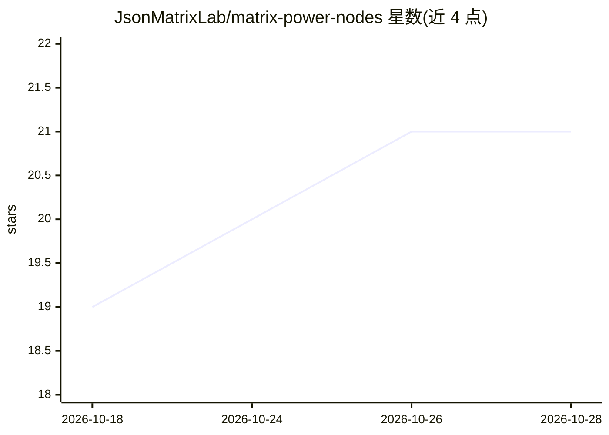

# JsonMatrixLab/matrix-power-nodes

⭐ 21 · Python · MIT · 推送 2026-07-30 · [GitHub](https://github.com/JsonMatrixLab/matrix-power-nodes) · 组织维护

**ComfyUI 自定义节点包：通过 WaveSpeed 生成 25 镜头 AI 图像数据集**

面向 ComfyUI 用户的 Dataset Workflow V1（0.1.0）：提供 MATRIX_DatasetConfig 与 MATRIX_DatasetImage 两个 Custom API Nodes 及一个可配置的 25 镜头 Face/Body 工作流，接收最多 14 个原生 IMAGE 引用，生成 12 张人像与 13 张半身/全身图像，通过 WaveSpeed API 执行付费图像生成。默认 live=false 防止误触发付费请求，凭据不入工作流。明确声明仅覆盖单一参考图到数据集路径，非通用数据集系统；尚不在 Comfy Registry 或 ComfyUI Manager 中，需从 GitHub 安装。

## 筛选速览

| 维度 | 判定 | 备注 |
|---|---|---|
| AI 角色 | `ai-native` | 本体是模型或模型工具 |
| 许可风险 | `permissive` | MIT |
| 部署形态 | `None` |  |
| 模型依赖 | — | README 未给出锁定关系 |
| 硬件要求 | — | 无带数字的原话,不猜 |
| 安装摩擦 | `medium` | 含编译或系统依赖之一 |
| 成熟度 | `idea` | |

## 能力要点

- 两个自定义节点 + 25 镜头 Face/Body 工作流
- 接收最多 14 个 ComfyUI IMAGE 引用，生成 25 张数据集图像
- live=false 默认值与凭据隔离的付费安全机制
- 无额外 pip 依赖

## 适用场景

- 在 ComfyUI 中批量生成角色一致性数据集
- 按镜头单独选购并控制付费生成成本
- 为图像训练准备 25 镜头人像/全身数据

## 场景标签

`图像生成` · 领域:内容生成

## 证据(README 行号)

> L7: Dataset Workflow V1 (package version 0.1.0): two ComfyUI Custom API Nodes and one
> L21: - Generates 12 portrait shots and 13 full- or half-body shots.

## 星数曲线

2026-10-18 19 → 2026-10-28 21（+2）

---
*卡片 v1 · prompt 1.4 · 生成 2026-10-28 · 置信度 high · 依据 README sha `a3317d516758` · [字段定义](../../DATASET.md)*
