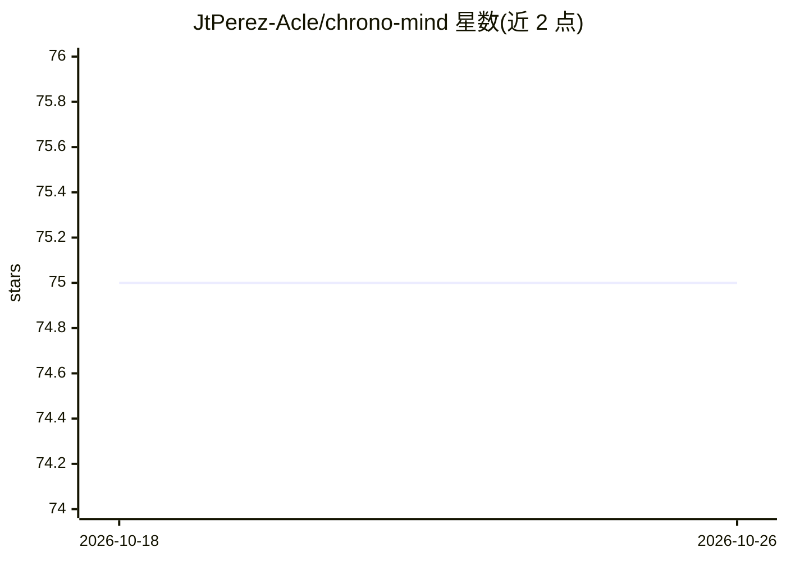

# JtPerez-Acle/chrono-mind

⭐ 75 · Rust · Apache-2.0 · 推送 2026-06-12 · [GitHub](https://github.com/JtPerez-Acle/chrono-mind) · 个人维护

**Rust 无锁并发 HNSW 向量索引库，附面向 AI agent 的时间性记忆层**

以 Cargo crate 形式提供的 HNSW 向量索引：读操作 wait-free、写操作 lock-free，通过 `&self` API 跨线程共享，不依赖 mutex/RwLock；以 loom、Miri、ThreadSanitizer、差分 oracle 等 CI 门禁验证并发正确性。索引之上提供时间性记忆层：向量携带 importance、decay rate 与访问历史，搜索将几何距离与新近度加权混合。约束：节点 arena 为 append-only，重写 embedding 会分配新槽位，需周期性快照重载压缩。另提供 PyO3 绑定与三套 A/B 基准（含与 usearch、FAISS 的对比数据）。

## 筛选速览

| 维度 | 判定 | 备注 |
|---|---|---|
| AI 角色 | `ai-ecosystem` | LLM/agent 周边工具 |
| 许可风险 | `permissive` | Apache-2.0 |
| 部署形态 | `library` | 以包/库形式分发 |
| 模型依赖 | — | README 未给出锁定关系 |
| 硬件要求 | — | 无带数字的原话,不猜 |
| 安装摩擦 | `low` | 无编译、无系统依赖或容器化 |
| 成熟度 | — | 结构信号不足 |

## 能力要点

- 读 wait-free / 写 lock-free 的 HNSW 索引，`&self` API 跨线程共享
- 时间性记忆层：importance 衰减 + 新近度与几何距离混合打分
- loom/Miri/TSan/差分 oracle 等并发正确性 CI 门禁
- PyO3 Python 绑定及与 usearch、FAISS 的 ann-benchmarks 对比

## 适用场景

- 在多线程读写并发的场景下做向量近邻检索
- 为 AI agent 构建带重要度衰减的记忆存储
- 通过 Python 绑定在 embedding 检索流程中使用该索引

## 场景标签

`向量数据库` `Agent 记忆` · 领域:Agent 开发

## 证据(README 行号)

> L7: **A lock-free concurrent HNSW vector index — wait-free reads, lock-free
> L19: On top sits a **temporal memory layer** for agent use cases: vectors carry
> L20: importance, decay rate, and access history, and search blends geometric

## 星数曲线

2026-10-18 75 → 2026-10-26 75（+0）

---
*卡片 v1 · prompt 1.4 · 生成 2026-10-24 · 置信度 high · 依据 README sha `04a7579d6296` · [字段定义](../../DATASET.md)*
