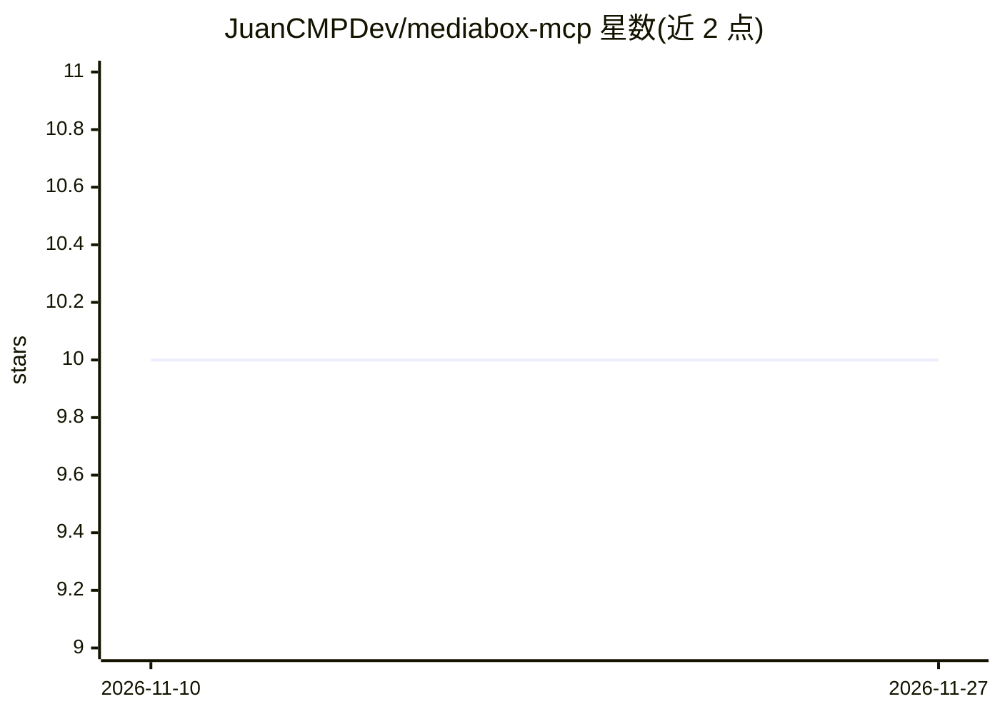

# JuanCMPDev/mediabox-mcp

⭐ 10 · TypeScript · MIT · 推送 2026-09-15 · [GitHub](https://github.com/JuanCMPDev/mediabox-mcp) · [官网](https://www.createmediabox.dev) · 个人维护

**自托管媒体服务器编排器，经 MCP 由 AI 助手管理 Jellyfin 等服务**

通过 MCP 协议将 Jellyfin、Sonarr、Radarr、qBittorrent、PyLoad 等自托管媒体服务暴露为 30 个 AI 可调用工具，支持经 OAuth 保护的 Streamable HTTP 接入。提供三种运行形态：Tauri 桌面应用（内置设置向导、仪表盘、AI 聊天）、`create-mediabox` CLI 向导（面向 Linux 服务器/VPS）、以及无头 MCP 服务器，三者共享同一 Docker 栈与编排管线，可自动完成 API key 提取、服务互联、媒体库配置等约 15 个手动步骤。依赖 Docker、Docker Compose 与 Node.js >= 20，MIT 许可。

## 筛选速览

| 维度 | 判定 | 备注 |
|---|---|---|
| AI 角色 | `ai-enhanced` | 去掉 AI 部分产品仍成立 |
| 许可风险 | `permissive` | MIT |
| 部署形态 | `self-host` | docker 或自建部署 |
| 模型依赖 | — | README 未给出锁定关系 |
| 硬件要求 | — | 无带数字的原话,不猜 |
| 安装摩擦 | `low` | 无编译、无系统依赖或容器化 |
| 成熟度 | — | 结构信号不足 |

## 能力要点

- 30 个 MCP 工具覆盖 Jellyfin/Sonarr/Radarr/下载/维护五类操作
- 三种运行形态（桌面应用/CLI 向导/无头 MCP 服务器）共享同一 Docker 栈
- 向导自动完成服务互联：提取 API key、配置下载客户端、同步索引器
- 支持 Local/VPS（Caddy 自动 HTTPS）/Cloudflare Tunnel 三种部署模式

## 适用场景

- 在家庭服务器上搭建并管理 Jellyfin 全家桶媒体栈
- 通过 Claude Desktop 或 Telegram 机器人用自然语言管理剧集和电影下载
- 在 VPS 上用一条命令完成带 HTTPS 的无人值守部署

## 场景标签

`工作流自动化` · 领域:效率与自动化

## 证据(README 行号)

> L5:  Self-hosted media server with AI-powered management via MCP, a native Desktop App, and a Telegram bot
> L21: |**Desktop App (Tauri)**|Recommended for Windows/macOS and local-first installs with a built-in setup wizard, dashb
> L23: |**Headless MCP server**|Plug the running stack into Claude Desktop, ChatGPT, Gemini, an OpenAI-compatible client, 

## 星数曲线

2026-11-10 10 → 2026-11-27 10（+0）

---
*卡片 v1 · prompt 1.4 · 生成 2026-11-20 · 置信度 high · 依据 README sha `d1ee0d79bb22` · [字段定义](../../DATASET.md)*
