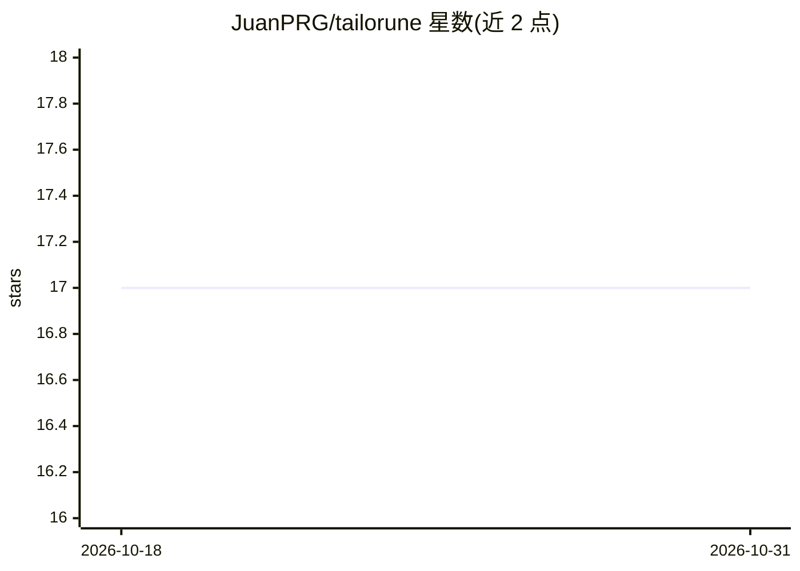

# JuanPRG/tailorune

⭐ 17 · JavaScript · MIT · 推送 2026-10-16 · [GitHub](https://github.com/JuanPRG/tailorune) · [官网](https://chromewebstore.google.com/detail/tailorune/chnibpoikgjckekkgpoeejdnmempllkh) · 个人维护

**Chrome 浏览器扩展：用自带 AI key 定制简历与求职信**

Manifest V3 Chrome 扩展，面向求职者：从当前职位页面读取职位描述，对上传的简历（.txt/.docx/.pdf）改写摘要与要点表述，生成 .docx 与 .pdf 各两份（简历+求职信）写入 Downloads。姓名、联系方式、任职日期等为锁定字段不进入模型改写范围，每次运行附带不可关闭的漂移检查，可选二次 AI 审查。无账号、无服务器，用户自带 Google Gemini/Groq/OpenRouter key，多 key 时按步骤轮换提供商；数据留存本机，仅简历文本与职位描述发往所选提供商。正常安装路径为 Chrome Web Store，源码构建需 npm。

## 筛选速览

| 维度 | 判定 | 备注 |
|---|---|---|
| AI 角色 | `ai-native` | 本体是模型或模型工具 |
| 许可风险 | `permissive` | MIT |
| 部署形态 | `library` | 以包/库形式分发 |
| 模型依赖 | locked-api |  |
| 硬件要求 | — | 无带数字的原话,不猜 |
| 安装摩擦 | `medium` | 含编译或系统依赖之一 |
| 成熟度 | — | 结构信号不足 |

## 能力要点

- 锁定字段机制：身份、雇主、日期等不经模型改写，仅改写摘要与要点措辞
- 自带 key 多提供商轮换（Gemini/Groq/OpenRouter），无服务器无账号
- 一次生成 .docx 与 .pdf 两种格式的简历与求职信
- 每次运行附自动漂移检查，可选二次 AI 审查（各为建议性，不拦截文档）

## 适用场景

- 投递前把简历针对具体职位描述快速改写
- 批量申请时复用简历库并按职位生成对应文件
- 不希望简历上传第三方服务的本地化求职文书处理

## 场景标签

`AI 写作` · 领域:内容生成

## 证据(README 行号)

> L20: Read the job off the tab you are on, and get a rewritten resume and a matching
> L73: **2. Get a free AI key.** The only fiddly step, and about two minutes.

## 星数曲线

2026-10-18 17 → 2026-10-31 17（+0）

---
*卡片 v1 · prompt 1.4 · 生成 2026-10-30 · 置信度 high · 依据 README sha `7bb49701471b` · [字段定义](../../DATASET.md)*
