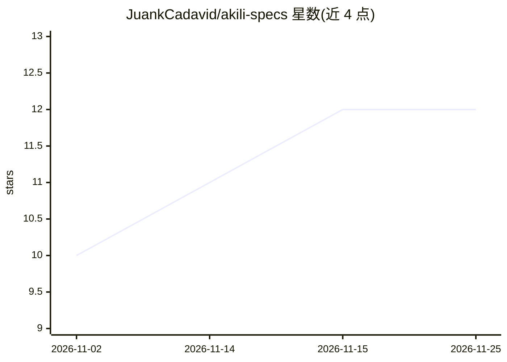

# JuankCadavid/akili-specs

⭐ 12 · JavaScript · MIT · 推送 2026-11-19 · [GitHub](https://github.com/JuankCadavid/akili-specs) · [官网](https://akili.com.co/) · 个人维护

**为 AI 编码助手添加规格驱动开发流程的命令与技能包**

AKILI 通过 npm 包向 AI 编码助手安装 slash 命令与技能文件：先写规格（requirements/design/tasks），再执行、测试、对照规格校验并归档学习。项目级基线由 /akili-constitution 一次性生成，另有 /akili-quick 小改动捷径、安全审计、PR 审查、SEO 与营销内容命令。支持 Claude Code、OpenCode、Google Antigravity、OpenAI Codex CLI、Cursor、Grok Bot，提供终端 CLI（init/install/doctor/update 等）与按步骤选择模型的 routing 功能。安全审计命令不支持原生 Windows。

## 筛选速览

| 维度 | 判定 | 备注 |
|---|---|---|
| AI 角色 | `ai-ecosystem` | LLM/agent 周边工具 |
| 许可风险 | `permissive` | MIT |
| 部署形态 | `library` | 以包/库形式分发 |
| 模型依赖 | — | README 未给出锁定关系 |
| 硬件要求 | — | 无带数字的原话,不猜 |
| 安装摩擦 | `low` | 无编译、无系统依赖或容器化 |
| 成熟度 | — | 结构信号不足 |

## 能力要点

- propose→specify→execute→test→validate→archive 的规格驱动流程命令
- /akili-constitution 生成项目级基线文档，会话间共享上下文
- akili routing 可为每个流程步骤指定所用 AI 模型
- 内置安全审计与 PR 审查命令，可接入 CI

## 适用场景

- 让 AI 编码助手按先写规格再编码的流程工作
- 对代码仓库做与产品文档一致性检查和安全审计
- 在 PR 审查中对照规格检查改动

## 场景标签

`提示工程` · 领域:Agent 开发

## 证据(README 行号)

> L12: Spec-driven development for AI coding assistants: plan the change, build it, test it, and learn from it.
> L25: AKILI adds slash commands and skills to your AI coding assistant.
> L131: |`akili routing`|choose which AI model runs each step (model routing)|

## 星数曲线

2026-11-02 10 → 2026-11-25 12（+2）

---
*卡片 v1 · prompt 1.4 · 生成 2026-11-18 · 置信度 high · 依据 README sha `939934aca277` · [字段定义](../../DATASET.md)*
