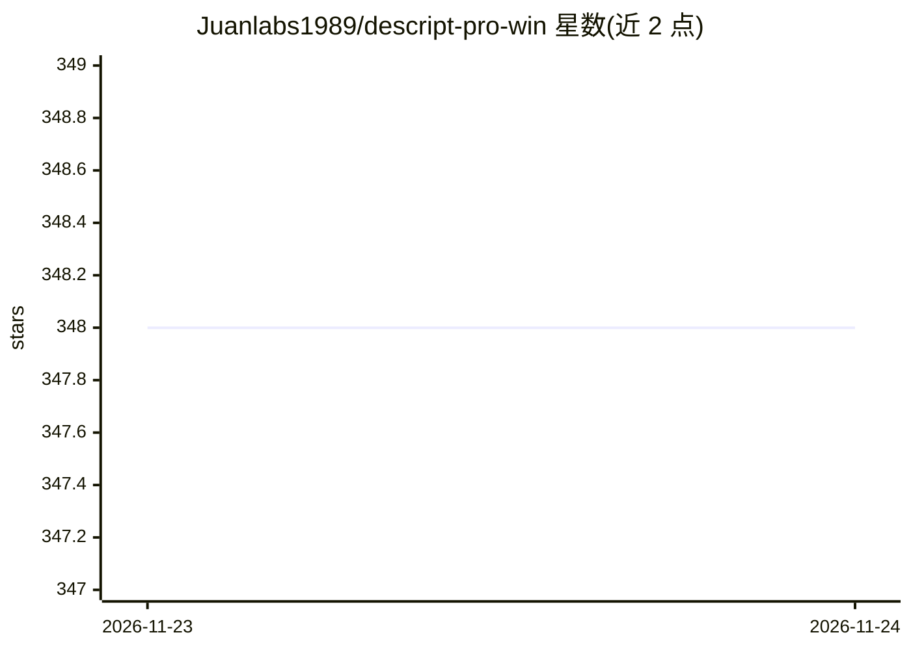

# Juanlabs1989/descript-pro-win

⭐ — · [GitHub]() · 个人维护

**Windows 用户的 Descript Pro 视频播客编辑器安装与使用指南**

面向 Windows 10/11 用户的 Descript Pro 参考与设置指南：介绍该 AI 视频与播客编辑器的文本化编辑（通过编辑转录文本剪切音视频）、自动转录、屏幕录制、音频清理、填充词移除、Overdub 语音生成与多轨合成等能力，并给出系统要求（x64、四核 CPU、8-16 GB 内存、DirectX 11、VC++ 运行库）、安装步骤、工作流程、兼容性说明与 FAQ。仓库本身不含软件代码，仅提供安装包下载指引与使用文档，许可条款指向供应商官方条款。

## 筛选速览

| 维度 | 判定 | 备注 |
|---|---|---|
| AI 角色 | `ai-knowledge` | 知识聚合/清单类 |
| 许可风险 | `none` | — |
| 部署形态 | `None` |  |
| 模型依赖 | — | README 未给出锁定关系 |
| 硬件要求 | — | 无带数字的原话,不猜 |
| 安装摩擦 | `low` | 无编译、无系统依赖或容器化 |
| 成熟度 | — | 结构信号不足 |

## 能力要点

- 文本化编辑：编辑转录文本即可自动剪切对应音视频
- 覆盖转录、屏幕录制、音频清理、填充词移除等 AI 功能说明
- 完整系统要求与运行时依赖清单（DirectX 11、VC++ Redistributable 等）
- 从安装到导出分享的五步工作流程说明

## 适用场景

- 在 Windows 10/11 上安装并配置 Descript Pro
- 通过编辑文稿的方式剪辑播客、教程与访谈视频
- 录制屏幕与讲解并生成字幕/转录文本

## 场景标签

`教程课程` · 领域:学习与行业

## 证据(README 行号)

> L3:  A Windows reference and setup guide for Descript Pro, transcription and screen recording capabilities, system profi
> L19: Descript Pro is an AI-powered video and podcast editor that lets you edit audio and video by editing text, much lik

## 星数曲线

2026-11-23 348 → 2026-11-24 348（+0）

---
*卡片 v1 · prompt 1.4 · 生成 2026-11-23 · 置信度 mid · 依据 README sha `d9901a731774` · [字段定义](../../DATASET.md)*
