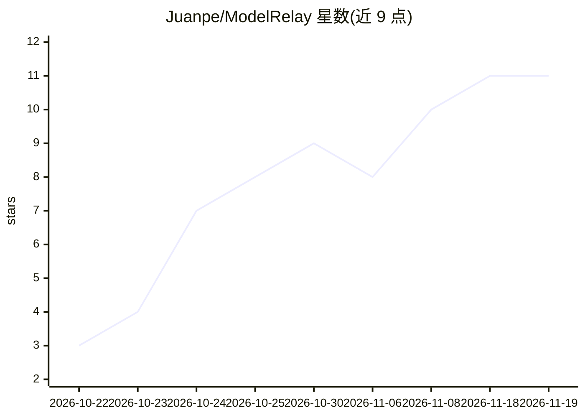

# Juanpe/ModelRelay

⭐ 11 · Swift · MIT · 推送 2026-10-28 · [GitHub](https://github.com/Juanpe/ModelRelay) · [官网](https://juanpecatalan.com) · 个人维护

**Swift 开发者的多步 AI 工作流编排库：分步选型、类型化传递**

面向 Swift/iOS/macOS 开发者的工作流编排包：将提取、分类、工具调用、自定义 Swift 步骤等组成一个 Workflow，每步可选择不同模型，步骤间以类型化 Value 传递命名结果。基于 AnyLanguageModel 做推理，支持 Apple 端侧模型、云提供商、OpenAI 兼容服务器与可选 MLX 本地运行；提供 MCP/HTTP 工具接入、写入审批策略、执行预算、检查点恢复与人工审批门。以 Swift Package Manager 多产品形式分发，核心依赖仅 AnyLanguageModel。

## 筛选速览

| 维度 | 判定 | 备注 |
|---|---|---|
| AI 角色 | `ai-ecosystem` | LLM/agent 周边工具 |
| 许可风险 | `permissive` | MIT |
| 部署形态 | `None` |  |
| 模型依赖 | local-ok | 支持本地模型 |
| 硬件要求 | — | 无带数字的原话,不猜 |
| 安装摩擦 | `medium` | 含编译或系统依赖之一 |
| 成熟度 | — | 结构信号不足 |

## 能力要点

- 每步可注册不同模型（Apple/Jev/Ollama/云/MLX），工作流定义保持不变
- 类型化命名结果在步骤间传递，支持分支与并行块
- MCP（Streamable HTTP）与 HTTP 工具接入，含写入审批与 local-only 策略
- start/resume 检查点与人工审批门，执行事件仅含元数据

## 适用场景

- 在 iOS 应用里把收据图像解析成类型化费用字段并校验
- 客服工单流：分类紧急度→工具查订单→交给回复 agent→人工审核后发送
- 同一流程内混用端侧 MLX 与云模型并配置回退

## 场景标签

`Agent 框架` · 领域:Agent 开发

## 证据(README 行号)

> L15: ModelRelay helps you connect those steps in Swift. Choose a model for each
> L19: Built on AnyLanguageModel
> L40: - 🧠 **Choose models per step:** Apple models, cloud providers, OpenAI-compatible servers and opt-in local MLX.
> L121: |`ModelRelay`|Workflows, typed values, builders, execution and custom Swift bodies|

## 星数曲线

2026-10-22 3 → 2026-11-19 11（+8）

---
*卡片 v1 · prompt 1.4 · 生成 2026-11-19 · 置信度 high · 依据 README sha `d25f74c2bbf5` · [字段定义](../../DATASET.md)*
