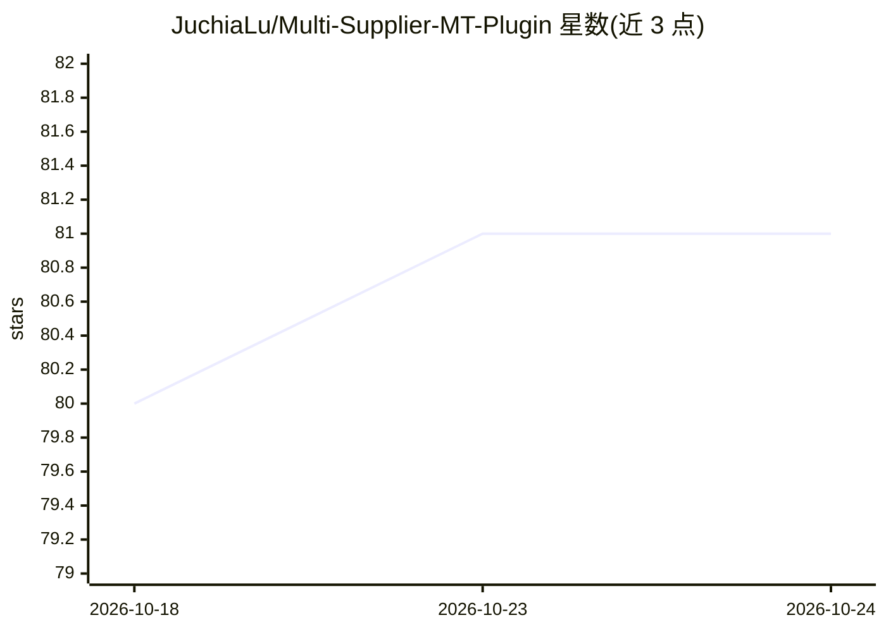

# JuchiaLu/Multi-Supplier-MT-Plugin

⭐ 81 · C# · MIT · 推送 2026-05-13 · [GitHub](https://github.com/JuchiaLu/Multi-Supplier-MT-Plugin) · 个人维护 · 中文 README

**memoQ 多提供商机器翻译插件：接入上百家翻译服务与 LLM**

面向 memoQ（9.14/11.4 已测试）用户的 CAT 机器翻译插件：支持上百家传统翻译提供商与大语言模型提供商，可自定义添加 OpenAI 兼容提供商，支持多重安装、批量与并行翻译请求、大小/速率/并发限制、失败重试及永久翻译缓存。LLM 场景提供术语表、上下文、翻译记忆、全文摘要等提示词占位符，并说明各家提示词缓存的价格与失效规则。安装方式为将 Release 中的 dll 放入 memoQ 插件目录。

## 筛选速览

| 维度 | 判定 | 备注 |
|---|---|---|
| AI 角色 | `ai-ecosystem` | LLM/agent 周边工具 |
| 许可风险 | `permissive` | MIT |
| 部署形态 | `desktop` | 安装包/桌面程序 |
| 模型依赖 | local-ok | 支持本地模型 |
| 硬件要求 | — | 无带数字的原话,不猜 |
| 安装摩擦 | `low` | 无编译、无系统依赖或容器化 |
| 成熟度 | — | 结构信号不足 |

## 能力要点

- 上百家翻译/LLM 提供商接入，支持自定义 OpenAI 兼容提供商
- 批量翻译、并行请求与大小/速率/并发/重试限制
- 翻译缓存默认开启，保留在数据库中永久有效
- LLM 提示词支持术语表、上下文、翻译记忆、全文摘要等占位符与提示词缓存策略

## 适用场景

- 在 memoQ 中直接使用各家提供商自家的 Key 享受免费额度
- 用大语言模型结合术语表和上下文批量翻译技术文档
- 多重安装插件以同时接入多个翻译提供商

## 场景标签

 · 领域:翻译工具/LLM 接入

## 证据(README 行号)

> L7: 由于 memoQ 是一款国外软件，国内的翻译服务提供商几乎没有接入，已有的 Tmxmall 和 Intento 插件虽然服务端集成了国内外几十家提供商，但不能填写提供商自家的 Key，各家提供商每月赠送有一定量的免费额度，使用 Tm
> L15: ✔ 服务提供商管理：自定义添加 OpenAI 兼容提供商、启用或禁用提供商
> L271: ## 10. 支持的大语言模型提供商

## 星数曲线

2026-10-18 80 → 2026-10-24 81（+1）

---
*卡片 v1 · prompt 1.4 · 生成 2026-10-24 · 置信度 high · 依据 README sha `f2e83078ff55` · [字段定义](../../DATASET.md)*
