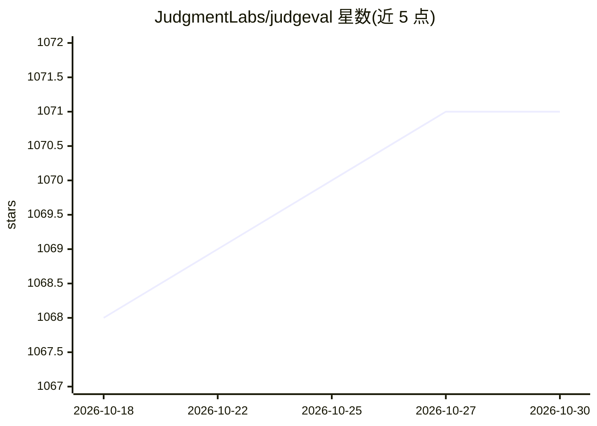

# JudgmentLabs/judgeval

⭐ 1,071 · Python · Apache-2.0 · 推送 2026-10-29 · [GitHub](https://github.com/JudgmentLabs/judgeval) · [官网](https://judgmentlabs.ai/) · 组织维护

**面向 LLM agent 的持续改进 SDK：tracing 与 agent-judge 评测监控**

开源 Python SDK，为 LLM 应用与 agent 提供基于 OpenTelemetry 的 tracing（@Tracer.observe() 自动捕获输入输出与 token 用量）和 prompt 驱动的 agent-judge 评测：对生产流量打分或回放历史 trace 验证修复效果，行为记录可检索。支持服务端在线监控与 Slack 告警，自动接入 OpenAI/Anthropic/Google GenAI/Together AI，并支持 LangGraph 等框架。附带 CLI 与 MCP Server，SQL 查询为只读、限制 1000 行/5MiB。使用需 Judgment API key。

## 筛选速览

| 维度 | 判定 | 备注 |
|---|---|---|
| AI 角色 | `ai-ecosystem` | LLM/agent 周边工具 |
| 许可风险 | `permissive` | Apache-2.0 |
| 部署形态 | `library` | 以包/库形式分发 |
| 模型依赖 | locked-api |  |
| 硬件要求 | — | 无带数字的原话,不猜 |
| 安装摩擦 | `low` | 无编译、无系统依赖或容器化 |
| 成熟度 | — | 结构信号不足 |

## 能力要点

- OpenTelemetry-based tracing，自动捕获输入输出与 LLM token 用量
- agent judges 可对生产流量打分或回放历史 trace 验证修复
- OpenAI/Anthropic/Google GenAI/Together AI 自动埋点，LangGraph/OpenLit/Claude Agent SDK 框架支持
- 提供 CLI 与 MCP Server，支持只读 SQL 查询 trace 数据

## 适用场景

- 给生产环境的 agent 检测失败并定位根因
- 上线前用历史 trace 回放验证修复效果
- 对线上流量做服务端自动评分并配置 Slack 回归告警

## 场景标签

`LLM 可观测性` `模型评测` · 领域:评测与运维

## 证据(README 行号)

> L19: Judgeval is an open-source Python SDK for agent improvement. It provides tracing and agent-judge evaluation for LLM
> L27: **Agent judges** -- Define prompt-based scorers to evaluate agent behaviors at scale. Judges produce structured beh
> L29: **Online monitoring** -- Automatically score live production traffic server-side with no latency impact. Detected b

## 星数曲线

2026-10-18 1,068 → 2026-10-30 1,071（+3）

---
*卡片 v1 · prompt 1.4 · 生成 2026-10-21 · 置信度 high · 依据 README sha `373ddeb60624` · [字段定义](../../DATASET.md)*
