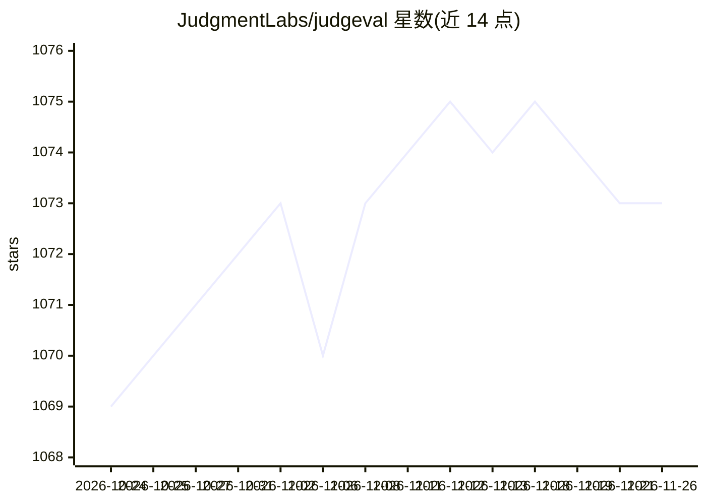

# JudgmentLabs/judgeval

⭐ 1,073 · Python · Apache-2.0 · 推送 2026-11-25 · [GitHub](https://github.com/JudgmentLabs/judgeval) · [官网](https://judgmentlabs.ai/) · 组织维护

**为 LLM agent 用户提供追踪与评估的开源 SDK**

Judgeval 是 Judgment Labs 维护的开源 Python SDK，面向构建 LLM agent 应用的开发者。核心机制包括：基于 OpenTelemetry 的函数级追踪（自动捕获输入、输出与 token 用量）、可定义的 prompt 评分器（Agent judges）对 trace 打标签、服务端在线监控并对回归配置 Slack 告警。支持 MCP server 插桩与只读 SQL 查询遥测数据。使用需配置 JUDGMENT_API_KEY 与 ORG_ID 凭据，依赖 Judgment 平台服务端。

## 筛选速览

| 维度 | 判定 | 备注 |
|---|---|---|
| AI 角色 | `ai-ecosystem` | LLM/agent 周边工具 |
| 许可风险 | `permissive` | Apache-2.0 |
| 部署形态 | `library` | 以包/库形式分发 |
| 模型依赖 | — | README 未给出锁定关系 |
| 硬件要求 | — | 无带数字的原话,不猜 |
| 安装摩擦 | `low` | 无编译、无系统依赖或容器化 |
| 成熟度 | — | 结构信号不足 |

## 能力要点

- 基于 OpenTelemetry 的追踪，@Tracer.observe() 自动捕获输入输出与 token 用量
- prompt-based Agent judges 可对生产流量实时打标或回放历史 trace 验证修复
- MCP server 插桩，工具调用生成子 span，支持会话分组
- 提供 CLI 与 MCP Server 接口，可在终端或 AI 助手中查询 trace 与运行评估

## 适用场景

- 监控生产环境 agent 的失败案例并配置告警
- 用 Agent judges 大规模评估 agent trace 质量
- 追踪 MCP server 的工具调用并排查故障
- 通过只读 SQL 查询遥测数据做历史分析

## 场景标签

`LLM 可观测性` `模型评测` · 领域:评测与运维

## 证据(README 行号)

> L19: Judgeval is an open-source Python SDK for agent improvement. It provides tracing and Agent judge evaluation for LLM
> L25: **OpenTelemetry-based tracing** -- Instrument any function with `@Tracer.observe()`. Automatically captures inputs,
> L31: **Broad integrations** -- Auto-instrumentation for OpenAI, Anthropic, Google GenAI, and Together AI. Framework supp

## 星数曲线

2026-10-24 1,069 → 2026-11-26 1,073（+4）

---
*卡片 v1 · prompt 1.4 · 生成 2026-11-24 · 置信度 high · 依据 README sha `310b60ee55f9` · [字段定义](../../DATASET.md)*
