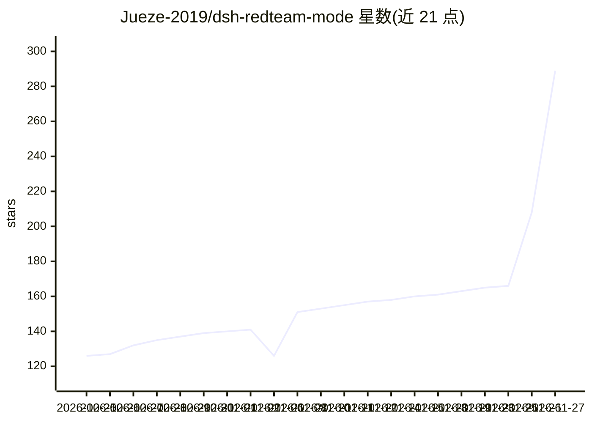

# Jueze-2019/dsh-redteam-mode

⭐ 289 · JavaScript · MIT · 推送 2026-11-25 · [GitHub](https://github.com/Jueze-2019/dsh-redteam-mode) · 个人维护 · 中文 README

**DSH 红队插件：编排多角色智能体执行授权渗透测试**

运行在 DeepSeek Harness 内的插件，按“信息收集→漏洞发现→漏洞利用→内网渗透”流程编排七个角色，主会话负责计划与派活。资产、端口、漏洞、凭据、证据等战果写入本机 SQLite 事实库，配套 9 页控制台与得分报告机制；随包提供 63 个工具定义与 41 个技能，但不含攻击工具二进制，工具与环境由使用者自备。仅面向已授权攻防演练，README 附中国网络安全相关法律边界说明。

## 筛选速览

| 维度 | 判定 | 备注 |
|---|---|---|
| AI 角色 | `ai-native` | 本体是模型或模型工具 |
| 许可风险 | `permissive` | MIT |
| 部署形态 | `None` |  |
| 模型依赖 | — | README 未给出锁定关系 |
| 硬件要求 | — | 无带数字的原话,不猜 |
| 安装摩擦 | `low` | 无编译、无系统依赖或容器化 |
| 成熟度 | — | 结构信号不足 |

## 能力要点

- 七个角色分工编排红队流程，执行角色为叶子节点不再委派
- 资产/漏洞/凭据/证据统一写入本机 SQLite 事实库，无遥测与云端同步
- 随包 41 个技能、63 个工具定义，缺工具或环境变量时直接说明
- 内置得分规则与可复现交付报告生成

## 适用场景

- 已授权的攻防演练中组织红队测试流程
- 渗透测试中统一管理资产、战果与证据台账
- 多会话并行跟踪多个靶标的测试进度

## 场景标签

`网络安全` `多智能体` · 领域:Agent 开发

## 证据(README 行号)

> L3: DSH RedTeam 模式运行在 DeepSeek Harness（DSH）里，用来组织红队测试流程。
> L5: 漏洞利用 → 内网信息收集 → 内网渗透”的顺序安排智能体，并把过程、证据和
> L18: - **角色分工**：主会话负责计划、派活和汇总，信息收集、资产梳理、漏洞发现、

## 星数曲线

2026-10-25 126 → 2026-11-27 289（+163）

---
*卡片 v1 · prompt 1.4 · 生成 2026-11-26 · 置信度 high · 依据 README sha `6ba5eca39ae2` · [字段定义](../../DATASET.md)*
