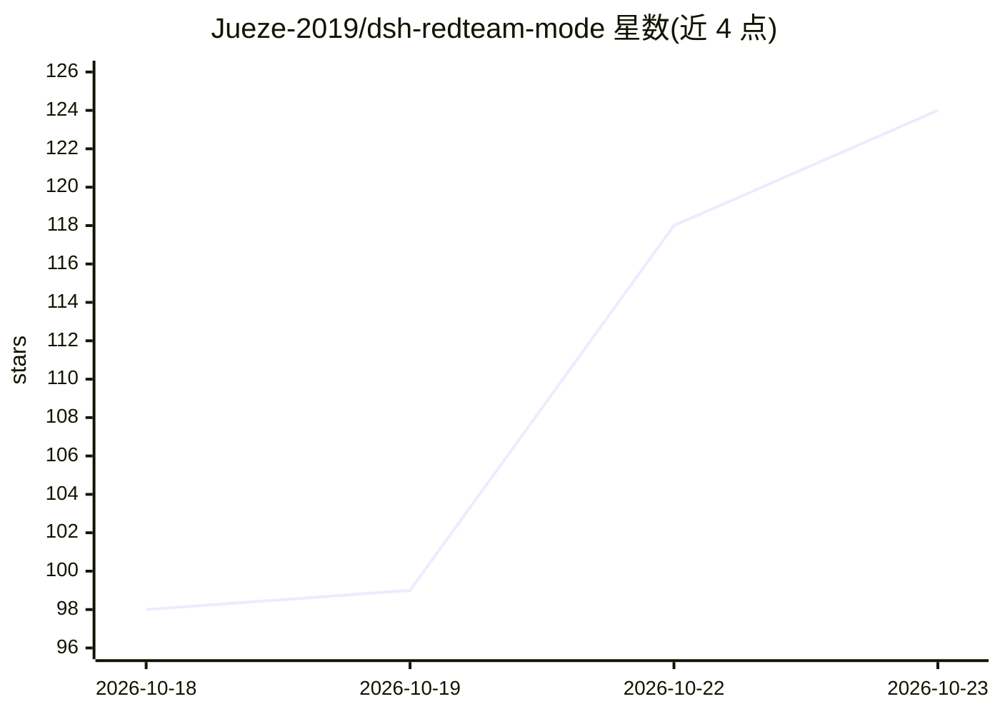

# Jueze-2019/dsh-redteam-mode

⭐ 124 · JavaScript · MIT · 推送 2026-10-22 · [GitHub](https://github.com/Jueze-2019/dsh-redteam-mode) · 个人维护 · 中文 README

**把 DeepSeek Harness 变成红队指挥台的智能体编排插件（仅限授权测试）**

面向已授权攻防演练与渗透测试的 DSH 插件：输入一个靶标单位名称，主会话以指挥角色派活给信息收集、资产梳理、漏洞发现、漏洞利用、内网渗透五个执行智能体角色（默认 3 个并发可配置），发现实时落入本机 SQLite 事实库（22 张表），界面右侧常驻控制台提供 5 分区 10 页面可视化。随包 16 个技能与 56 个 redteam_* 工具，含预检、得分判定与四段式报告生成。仓库声明不含漏洞利用代码，数据只在本机、无遥测。安装经 dsh plugin 命令或 Release tarball/源码，前置 Node.js ≥22.13 与 DSH 环境，建议运行在专供演练的 Kali 虚拟机。

## 筛选速览

| 维度 | 判定 | 备注 |
|---|---|---|
| AI 角色 | `ai-native` | 本体是模型或模型工具 |
| 许可风险 | `permissive` | MIT |
| 部署形态 | `None` |  |
| 模型依赖 | — | README 未给出锁定关系 |
| 硬件要求 | — | 无带数字的原话,不猜 |
| 安装摩擦 | `low` | 无编译、无系统依赖或容器化 |
| 成熟度 | — | 结构信号不足 |

## 能力要点

- 一个靶标名称拉起五个执行智能体角色的编排流水线
- 发现实时写入本机 SQLite 事实库（22 张表），右侧常驻控制台可视化
- 56 个 redteam_* 工具 + 16 个随包技能（另 9 个攻击链技能在 Release 工具箱）
- 四段式报告生成与机密信息入库拦截（git pre-commit 闸门 + 回归测试）

## 适用场景

- 授权攻防演练中按靶标单位组织多智能体渗透流程
- 红蓝对抗中集中管理资产、凭据与漏洞战果并生成报告
- 企业自检或教学研究中做信息收集与资产梳理

## 场景标签

`多智能体` `网络安全` · 领域:Agent 开发

## 证据(README 行号)

> L3: 把 DeepSeek Harness（DSH）变成一台**红队作战指挥台**：
> L4: 只发一个靶标单位名称，主会话拉起一支执行智能体团队（信息收集 → 资产梳理 → 漏洞发现 → 漏洞利用 → 内网渗透），
> L5: 所有发现实时落进本机 SQLite 事实库，并在界面右侧栏的常驻控制台里可视化。

## 星数曲线

2026-10-18 98 → 2026-10-23 124（+26）

---
*卡片 v1 · prompt 1.4 · 生成 2026-10-23 · 置信度 high · 依据 README sha `d3e3236b3651` · [字段定义](../../DATASET.md)*
