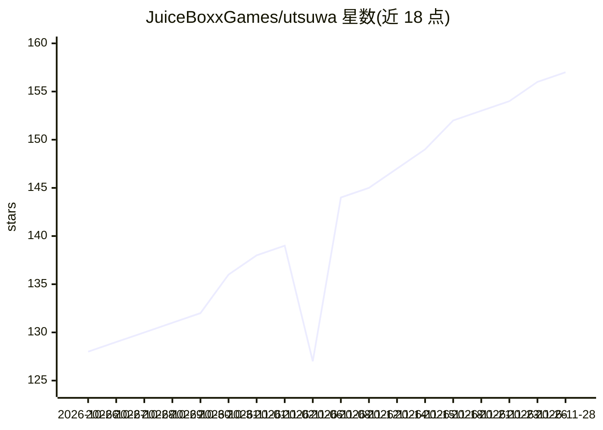

# JuiceBoxxGames/utsuwa

⭐ 157 · TypeScript · AGPL-3.0 · 推送 2026-11-27 · [GitHub](https://github.com/JuiceBoxxGames/utsuwa) · [官网](https://www.utsuwa.ai) · 组织维护

**开源虚拟 AI 伴侣应用：3D VRM 形象陪你聊天、成长**

自称 Grok Companion 的开源替代品：以 3D VRM 头像为载体的 AI 伴侣应用，提供聊天（流式输出、3D 气泡）、情绪表达、语音输入/输出、拍照模式、AR 展示、恋爱养成式关系系统（8 个关系阶段、多轴关系值、语义记忆）。数据经 IndexedDB 本地存储；支持 8 个 LLM 提供方（含 Ollama/LM Studio 本地模型）与 MCP 工具接入；可整体离线运行（本地 LLM+本地 STT+本地 TTS）。提供浏览器版与基于 Tauri 的 macOS/Windows/Linux 桌面版（beta，未签名），需 Node.js 22+ 环境。

## 筛选速览

| 维度 | 判定 | 备注 |
|---|---|---|
| AI 角色 | `ai-native` | 本体是模型或模型工具 |
| 许可风险 | `viral` | AGPL-3.0 |
| 部署形态 | `desktop` | 安装包/桌面程序 |
| 模型依赖 | local-ok | 支持本地模型 |
| 硬件要求 | — | 无带数字的原话,不猜 |
| 安装摩擦 | `low` | 无编译、无系统依赖或容器化 |
| 成熟度 | — | 结构信号不足 |

## 能力要点

- 3D VRM 头像：触控反应、情绪表情、口型同步、AR/拍照模式
- 支持 8 个 LLM 提供方，含 Ollama/LM Studio 本地模型发现与 OpenAI 兼容端点
- 语音输入经本地 Whisper 服务器、Groq 或浏览器 Web Speech API；TTS 支持 ElevenLabs/OpenAI/Fish Audio/本地 OmniVoice
- 恋爱养成系统：8 个关系阶段、多轴关系值、Transformers.js 本地语义记忆

## 适用场景

- 在本地设备上运行一个隐私优先的虚拟 AI 伴侣
- 用 Ollama/LM Studio 本地模型跑通全离线的陪伴对话与语音
- 通过 MCP 让伴侣调用 Home Assistant、网页搜索等外部工具

## 场景标签

`聊天机器人` · 领域:对话与助手

## 证据(README 行号)

> L41: **Utsuwa is an open-source AI companion with 3D VRM avatars.** A platform where you can have a virtual companion th
> L66: - **LLM Integration**: Support for 8 LLM providers: OpenAI, Anthropic, Google, xAI, DeepSeek, Ollama, LM Studio, an
> L82: - **Desktop App** *(beta)*: Native desktop app for macOS, Windows, and Linux with transparent overlay mode, so your

## 星数曲线

2026-10-26 128 → 2026-11-28 157（+29）

---
*卡片 v1 · prompt 1.4 · 生成 2026-11-28 · 置信度 high · 依据 README sha `40bf7a4f785f` · [字段定义](../../DATASET.md)*
