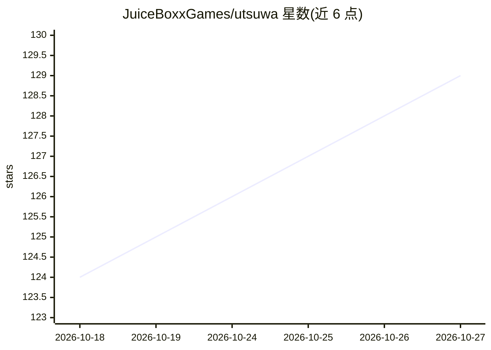

# JuiceBoxxGames/utsuwa

⭐ 129 · TypeScript · AGPL-3.0 · 推送 2026-10-26 · [GitHub](https://github.com/JuiceBoxxGames/utsuwa) · [官网](https://www.utsuwa.ai) · 组织维护

**带 3D VRM 化身的本地优先开源 AI 陪伴应用**

可浏览器运行或以桌面应用（Tauri，macOS/Windows/Linux）安装的 AI 陪伴平台：用户与 3D VRM 化身对话，化身有表情、动画、AR、拍照、触摸反应等交互。支持 8 类 LLM 提供商（含 Ollama/LM Studio 本地模型与 OpenAI 兼容端点）、多家 TTS 与本地 Whisper 语音输入，可全离线运行。内置多轴关系追踪、视觉小说事件与基于 Transformers.js 的本地语义记忆，数据存于本地 IndexedDB。桌面应用处于 beta 阶段。

## 筛选速览

| 维度 | 判定 | 备注 |
|---|---|---|
| AI 角色 | `ai-native` | 本体是模型或模型工具 |
| 许可风险 | `viral` | AGPL-3.0 |
| 部署形态 | `desktop` | 安装包/桌面程序 |
| 模型依赖 | local-ok | 支持本地模型 |
| 硬件要求 | — | 无带数字的原话,不猜 |
| 安装摩擦 | `low` | 无编译、无系统依赖或容器化 |
| 成熟度 | `idea` | |

## 能力要点

- 3D VRM 化身渲染，支持 AR、拍照、触摸反应与表情动画
- 支持 8 类 LLM 提供商，可配合 Ollama/LM Studio 全离线运行
- 本地语义记忆（Transformers.js 向量检索）与记忆图谱可视化
- 多轴关系追踪与 8 阶段恋爱模拟进展系统

## 适用场景

- 在桌面或浏览器中与 3D 虚拟陪伴角色对话互动
- 用 Ollama 等本地模型搭建完全离线的私人 AI 陪伴
- 体验带恋爱模拟机制的 AI 关系养成

## 场景标签

`聊天机器人` · 领域:对话与助手

## 证据(README 行号)

> L33: **Utsuwa is an open-source AI companion with 3D VRM avatars.** A platform where you can have a virtual companion th
> L58: - **LLM Integration**: Support for 8 LLM providers: OpenAI, Anthropic, Google, xAI, DeepSeek, Ollama, LM Studio, an
> L62: - **Fully Local Option**: Run the whole stack offline: local LLM (Ollama/LM Studio), local TTS, and local Whisper S

## 星数曲线

2026-10-18 124 → 2026-10-27 129（+5）

---
*卡片 v1 · prompt 1.4 · 生成 2026-10-23 · 置信度 high · 依据 README sha `17fd7980245b` · [字段定义](../../DATASET.md)*
