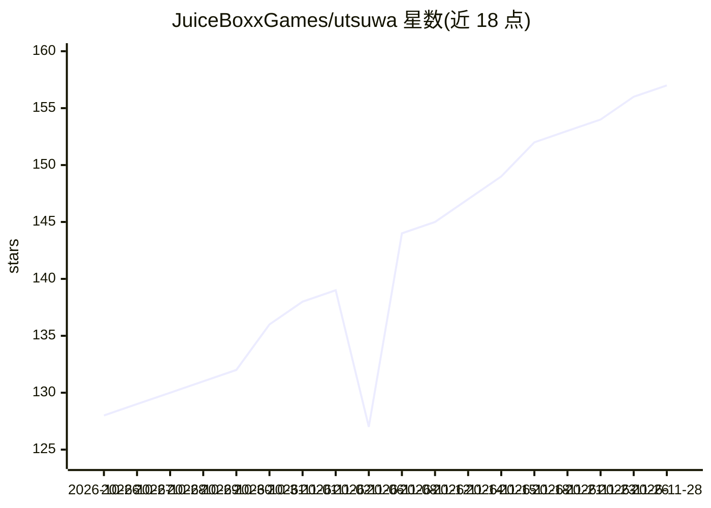

# JuiceBoxxGames/utsuwa

⭐ 157 · TypeScript · AGPL-3.0 · 推送 2026-11-27 · [GitHub](https://github.com/JuiceBoxxGames/utsuwa) · [官网](https://www.utsuwa.ai) · 组织维护

**开源虚拟 AI 陪伴应用：3D VRM 角色聊天、记忆与养成**

Utsuwa 是一个开源 AI 陪伴平台（自称 Grok Companion 的开源替代），以 3D VRM 头像呈现虚拟伴侣，支持聊天、心情表情、语音输入与 TTS 朗读、口型同步、AR 摆放与拍照模式。内置 dating sim 式养成系统：五维关系追踪、8 个关系阶段、语义记忆（本地 Transformers.js 向量检索）、记忆图谱与定时任务。数据经 IndexedDB 全本地存储。接入 8 家 LLM 提供商并支持 MCP 工具调用；可选 Ollama/LM Studio 实现全离线运行。提供 macOS/Windows/Linux 桌面安装包与浏览器版。

## 筛选速览

| 维度 | 判定 | 备注 |
|---|---|---|
| AI 角色 | `ai-native` | 本体是模型或模型工具 |
| 许可风险 | `viral` | AGPL-3.0 |
| 部署形态 | `desktop` | 安装包/桌面程序 |
| 模型依赖 | local-ok | 支持本地模型 |
| 硬件要求 | — | 无带数字的原话,不猜 |
| 安装摩擦 | `low` | 无编译、无系统依赖或容器化 |
| 成熟度 | — | 结构信号不足 |

## 能力要点

- 支持 8 家 LLM 提供商及任意 OpenAI 兼容端点，本地模型可直接发现
- VRM 3D 头像渲染：表情、动画、物理、口型同步、AR 模式与拍照模式
- dating sim 式养成：五维关系、8 阶段进度、视觉小说事件
- 语义记忆本地向量检索（Transformers.js，无 API 调用）与 MCP 工具接入

## 适用场景

- 想要一个可长期陪伴、带记忆与关系养成的虚拟 AI 伙伴
- 用本地 LLM 与本地语音模型搭建完全离线的桌面陪伴应用
- 给 VRM 头像加载自定义模型、动作与语音进行展示
- 通过 MCP 让陪伴角色调用 Home Assistant 等外部工具

## 场景标签

`聊天机器人` `语音合成` · 领域:对话与助手

## 证据(README 行号)

> L35: **Utsuwa is an open-source AI companion with 3D VRM avatars.** A platform where you can have a virtual companion th
> L60: - **LLM Integration**: Support for 8 LLM providers: OpenAI, Anthropic, Google, xAI, DeepSeek, Ollama, LM Studio, an
> L64: - **Fully Local Option**: Run the whole stack offline: local LLM (Ollama/LM Studio), local TTS, and local Whisper S

## 星数曲线

2026-10-26 128 → 2026-11-28 157（+29）

---
*卡片 v1 · prompt 1.4 · 生成 2026-11-27 · 置信度 high · 依据 README sha `2f7401d93fd1` · [字段定义](../../DATASET.md)*
