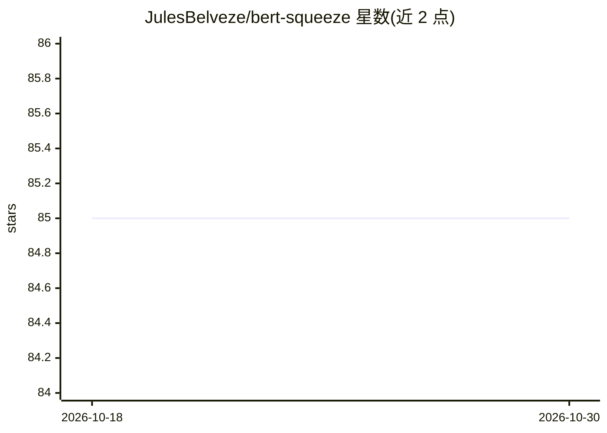

# JulesBelveze/bert-squeeze

⭐ 85 · Python · 推送 2026-09-30 · [GitHub](https://github.com/JulesBelveze/bert-squeeze) · [官网](https://julesbelveze.github.io/bert-squeeze/) · 个人维护

**面向 NLP 开发者的 Transformer 压缩工具库：蒸馏/剪枝/量化/早退**

基于 PyTorch Lightning 与 Transformers 编写的模型压缩库，目标是减小 Transformer 模型体积或降低推理延迟。提供知识蒸馏（软/硬蒸馏、任意教师到学生模型）、剪枝（head 剪枝、层丢弃、权重丢弃）、量化（动态量化与量化感知训练回调）等实现。当前仅支持序列分类任务，其他任务与自定义架构在路线图中；作者声明未对全部方法做充分测试。通过 git clone 加 uv 安装依赖运行。

## 筛选速览

| 维度 | 判定 | 备注 |
|---|---|---|
| AI 角色 | `ai-ecosystem` | LLM/agent 周边工具 |
| 许可风险 | `none` | — |
| 部署形态 | `library` | 以包/库形式分发 |
| 模型依赖 | — | README 未给出锁定关系 |
| 硬件要求 | — | 无带数字的原话,不猜 |
| 安装摩擦 | `low` | 无编译、无系统依赖或容器化 |
| 成熟度 | — | 结构信号不足 |

## 能力要点

- 软/硬蒸馏支持任意模型间的知识迁移
- 动态量化与量化感知训练（Lightning callback）
- head 剪枝、层丢弃、权重丢弃多种剪枝方法
- 基于 PyTorch Lightning 实现，支持 Aim 日志

## 适用场景

- 我要把大模型蒸馏成小模型以降低生产推理延迟
- 对序列分类模型做剪枝或量化以压缩体积
- 在 PyTorch Lightning 训练流程中接入压缩回调

## 场景标签

`模型量化` · 领域:训练与推理

## 证据(README 行号)

> L6: **Bert-squeeze** is a repository aiming to provide code to reduce the size of Transformer-based models or decrease t
> L9: It gathers a non-exhaustive list of techniques such as distillation, pruning, quantization, early-exiting. The repo 

## 星数曲线

2026-10-18 85 → 2026-10-30 85（+0）

---
*卡片 v1 · prompt 1.4 · 生成 2026-10-24 · 置信度 mid · 依据 README sha `503b892b3aba` · [字段定义](../../DATASET.md)*
