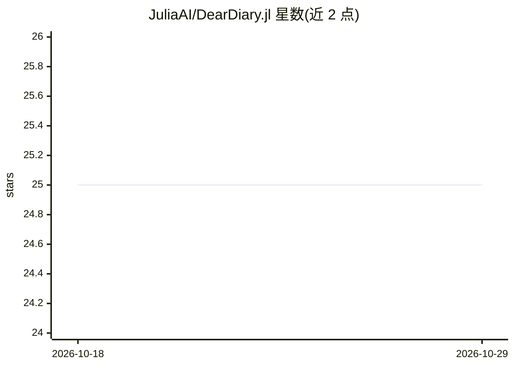

# JuliaAI/DearDiary.jl

⭐ 25 · Julia · MIT · 推送 2026-10-19 · [GitHub](https://github.com/JuliaAI/DearDiary.jl) · [官网](https://juliaai.github.io/DearDiary.jl/) · 组织维护

**Julia 编写的 ML 实验跟踪器：记录实验环境与指标**

面向 Julia 生态的机器学习实验跟踪库：跟踪项目、实验、迭代、参数、指标与带标签资源，迭代形成父子树以支持 HPO 扫描与分布式 worker。内置 REST API 服务端与 Julia 客户端，`with_iteration` 自动标记成功/失败并快照 `Manifest.toml`、Julia 版本与 git SHA，`DearDiary.restore` 可将环境重建到新目录。元数据存于单文件 DuckDB，artifact 可内联、存本地文件系统或 S3 兼容对象存储（AWS S3、MinIO、Cloudflare R2），并提供服务端渲染的 Web 面板与模型注册表。通过 Julia Pkg 安装。

## 筛选速览

| 维度 | 判定 | 备注 |
|---|---|---|
| AI 角色 | `ai-ecosystem` | LLM/agent 周边工具 |
| 许可风险 | `permissive` | MIT |
| 部署形态 | `None` |  |
| 模型依赖 | — | README 未给出锁定关系 |
| 硬件要求 | — | 无带数字的原话,不猜 |
| 安装摩擦 | `low` | 无编译、无系统依赖或容器化 |
| 成熟度 | — | 结构信号不足 |

## 能力要点

- 项目/实验/迭代四级跟踪面，迭代父子树支持 HPO 与分布式
- 每次迭代记录 Manifest.toml 快照、Julia 版本与 git SHA，支持环境重建
- 单文件 DuckDB 元数据存储，artifact 支持本地与 S3 兼容后端迁移
- 内置 REST API、Web 面板、用户权限管理与模型注册表

## 适用场景

- 我在 Julia 中训练模型时记录参数、指标与运行状态
- 我需要按每次运行快照依赖环境以便复现实验
- 团队通过远程 REST 客户端与 Web 面板管理实验和模型注册表

## 场景标签

`MLOps` · 领域:训练与推理

## 证据(README 行号)

> L1: # DearDiary.jl
> L37: Reproducible ML depends on knowing what code, data, and environment produced each result. Established trackers such

## 星数曲线

2026-10-18 25 → 2026-10-29 25（+0）

---
*卡片 v1 · prompt 1.4 · 生成 2026-10-27 · 置信度 high · 依据 README sha `4f91d9f4f7f2` · [字段定义](../../DATASET.md)*
