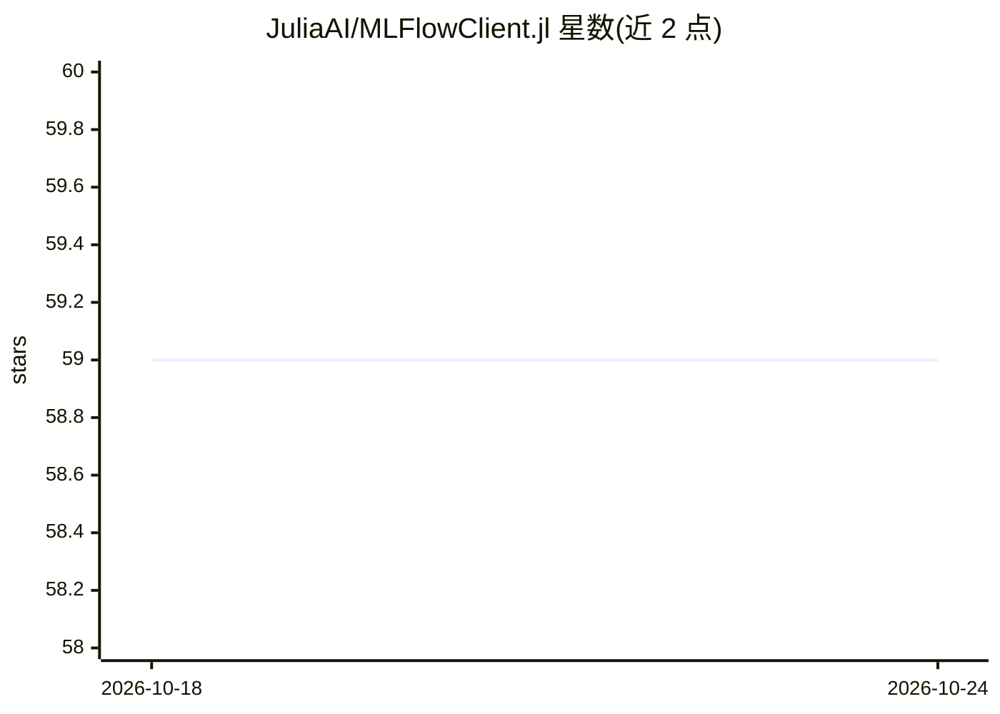

# JuliaAI/MLFlowClient.jl

⭐ 59 · Julia · MIT · 推送 2026-07-13 · [GitHub](https://github.com/JuliaAI/MLFlowClient.jl) · [官网](https://juliaai.github.io/MLFlowClient.jl/) · 组织维护

**Julia 语言的 MLflow 客户端：实验追踪与模型管理**

MLflow REST API 的 Julia 客户端库，面向使用 Julia 做机器学习的开发者，可在 Julia 代码中直接连接 MLflow 服务器，进行实验追踪、指标与参数记录、产物管理、注册模型及版本管理等操作。实现 MLflow REST API v2.0 与 v3.0 及认证 API，覆盖实验、运行、产物、注册模型、Gateway、Webhooks、RBAC 等操作。支持基本认证、Token 认证，并读取 MLFLOW_TRACKING_URI 等环境变量。已针对 MLflow 3.14.0 测试。通过 Julia Pkg 安装。

## 筛选速览

| 维度 | 判定 | 备注 |
|---|---|---|
| AI 角色 | `ai-ecosystem` | LLM/agent 周边工具 |
| 许可风险 | `permissive` | MIT |
| 部署形态 | `None` |  |
| 模型依赖 | — | README 未给出锁定关系 |
| 硬件要求 | — | 无带数字的原话,不猜 |
| 安装摩擦 | `low` | 无编译、无系统依赖或容器化 |
| 成熟度 | — | 结构信号不足 |

## 能力要点

- 实现 MLflow REST API v2.0 与 v3.0 全量操作
- 支持指标/参数/批量/模型/输入记录
- 产物支持上传/下载/分片上传/预签名 URL
- 支持 Basic/Token 认证并读取 MLflow 追踪环境变量

## 适用场景

- 在 Julia 训练脚本中记录实验指标与参数到 MLflow
- 从 Julia 注册与管理模型版本及别名
- 对接 MLflow v3.0 的 Gateway、Scorers、Review queues 等功能

## 场景标签

`MLOps` · 领域:训练与推理

## 证据(README 行号)

> L8: A Julia client for the MLflow REST API. Track experiments, log metrics and parameters, manage models, and more — dir
> L30: MLFlowClient implements the full MLflow REST API (v2.0 and v3.0) and the Authentication REST API:

## 星数曲线

2026-10-18 59 → 2026-10-24 59（+0）

---
*卡片 v1 · prompt 1.4 · 生成 2026-10-24 · 置信度 high · 依据 README sha `baccbce7653a` · [字段定义](../../DATASET.md)*
