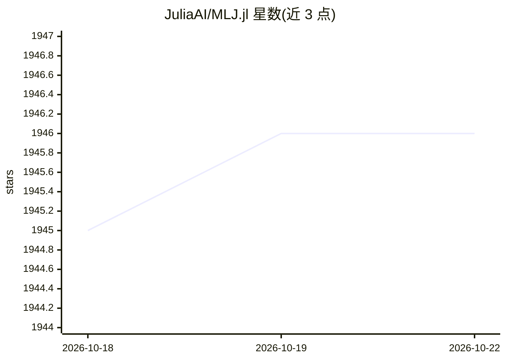

# JuliaAI/MLJ.jl

⭐ 1,948 · Julia · NOASSERTION · 推送 2026-10-19 · [GitHub](https://github.com/JuliaAI/MLJ.jl) · [官网](https://juliaml.ai) · 组织维护

**Julia 机器学习工具箱：统一接口组织 200+ 模型的调参与评估**

用 Julia 编写的机器学习工具箱，为 200 多个用 Julia 及其他语言编写的模型提供统一接口与元算法，覆盖模型选择、调参、评估、组合（pipeline/集成/堆叠）与比较。以伞形包形式发布，功能组件分布在多个其他包中。面向 Julia 用户与希望将已有机器学习模型接入该框架的开发者，提供稳定与开发版文档及 BibTeX 引用。

## 筛选速览

| 维度 | 判定 | 备注 |
|---|---|---|
| AI 角色 | `ai-ecosystem` | LLM/agent 周边工具 |
| 许可风险 | `permissive` | NOASSERTION |
| 部署形态 | `None` |  |
| 模型依赖 | — | README 未给出锁定关系 |
| 硬件要求 | — | 无带数字的原话,不猜 |
| 安装摩擦 | `low` | 无编译、无系统依赖或容器化 |
| 成熟度 | — | 结构信号不足 |

## 能力要点

- 统一接口对接 200+ Julia 及其他语言实现的模型
- 提供选择、调参、评估、组合与比较的元算法
- 伞形包结构，组件分布在多个独立包中
- 支持将已有机器学习模型接入框架

## 适用场景

- 在 Julia 中用统一 API 调用和比较多种机器学习模型
- 构建含调参与组合的机器学习流水线
- 把现有机器学习模型包装进统一框架

## 场景标签

`MLOps` · 领域:训练与推理

## 证据(README 行号)

> L26: MLJ (Machine Learning in Julia) is a toolbox written in Julia providing a common interface
> L27: and meta-algorithms for selecting, tuning, evaluating, composing and comparing over [200

## 星数曲线

2026-10-18 1,945 → 2026-10-22 1,946（+1）

---
*卡片 v1 · prompt 1.4 · 生成 2026-10-21 · 置信度 high · 依据 README sha `9371e8ac0e5d` · [字段定义](../../DATASET.md)*
