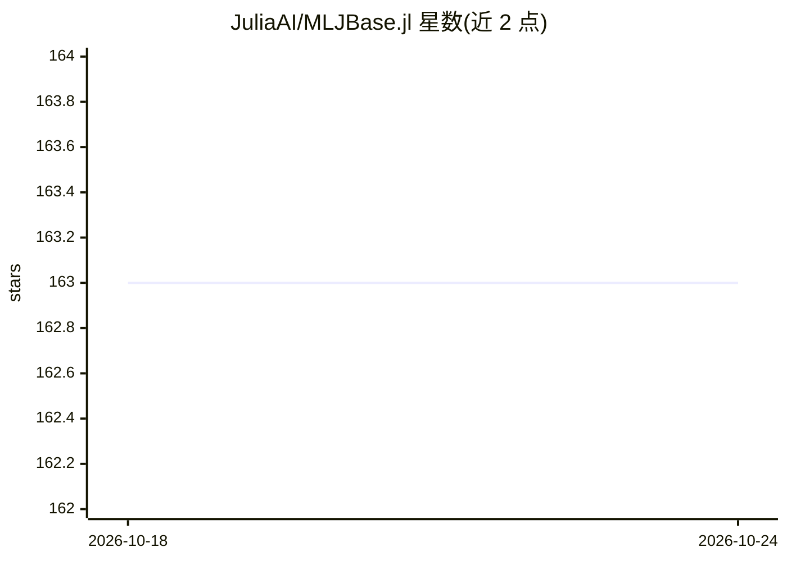

# JuliaAI/MLJBase.jl

⭐ 163 · Julia · MIT · 推送 2026-10-21 · [GitHub](https://github.com/JuliaAI/MLJBase.jl) · 组织维护

**MLJ 机器学习框架的核心功能库，供开发者使用**

Julia 语言 MLJ 机器学习框架的核心功能仓库，面向开发者而非终端用户。提供：补全 MLJModelInterface 轻量模型接口的方法、machine 抽象及其 fit!/predict/transform 方法、学习网络与管道及堆叠等模型组合接口、数据集操作与合成数据工具、CV/StratifiedCV/Holdout 等重采样策略与性能评估方法、一维超参数范围类型（配合 MLJTuning）。评估指标已迁移至 StatisticalMeasures.jl。

## 筛选速览

| 维度 | 判定 | 备注 |
|---|---|---|
| AI 角色 | `ai-ecosystem` | LLM/agent 周边工具 |
| 许可风险 | `permissive` | MIT |
| 部署形态 | `None` |  |
| 模型依赖 | — | README 未给出锁定关系 |
| 硬件要求 | — | 无带数字的原话,不猜 |
| 安装摩擦 | `low` | 无编译、无系统依赖或容器化 |
| 成熟度 | — | 结构信号不足 |

## 能力要点

- machine 抽象与 fit!/predict/transform 方法
- 学习网络、管道、堆叠、目标变换的模型组合接口
- CV/StratifiedCV/Holdout 重采样策略与性能评估方法
- 一维超参数范围类型，供 MLJTuning 使用

## 适用场景

- 为 MLJ 框架开发新模型接口
- 构建管道与堆叠等复合模型
- 执行交叉验证与模型性能评估

## 场景标签

`模型评测` · 领域:评测与运维

## 证据(README 行号)

> L3: Repository for developers that provides core functionality for the
> L14: MLJ is a Julia
> L15: framework for combining and tuning machine learning models. This

## 星数曲线

2026-10-18 163 → 2026-10-24 163（+0）

---
*卡片 v1 · prompt 1.4 · 生成 2026-10-22 · 置信度 high · 依据 README sha `e39d06906406` · [字段定义](../../DATASET.md)*
