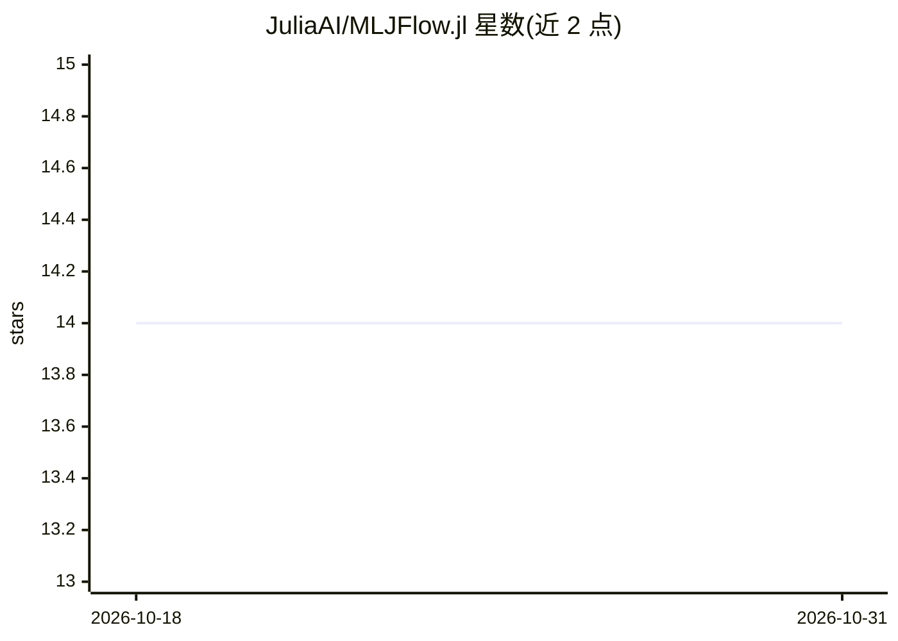

# JuliaAI/MLJFlow.jl

⭐ 14 · Julia · MIT · 推送 2026-08-17 · [GitHub](https://github.com/JuliaAI/MLJFlow.jl) · 组织维护

**Julia MLJ 与 MLflow 的集成包：模型训练/评测的实验追踪**

Julia 包，将 MLJ 机器学习框架接入 MLflow 作为后端，实现模型追踪与实验管理：自动化 MLflow 实验创建、运行记录与指标/参数/产物记录；提供 Logger 包装器，可作为 logger 关键字参数传入 MLJ 的 evaluate、TunedModel、IteratedModel 等工作流；扩展 MLJ.save 将训练好的 machine 保存为可取回的 MLflow artifact。需用户自行运行 MLflow API 服务，要求 MLJ 0.23 及以上版本并显式导入。项目源于 GSoC 2023。

## 筛选速览

| 维度 | 判定 | 备注 |
|---|---|---|
| AI 角色 | `ai-ecosystem` | LLM/agent 周边工具 |
| 许可风险 | `permissive` | MIT |
| 部署形态 | `None` |  |
| 模型依赖 | — | README 未给出锁定关系 |
| 硬件要求 | — | 无带数字的原话,不猜 |
| 安装摩擦 | `low` | 无编译、无系统依赖或容器化 |
| 成熟度 | — | 结构信号不足 |

## 能力要点

- Logger 包装器接入 MLJ 的 logger 关键字参数机制
- 支持 evaluate 性能评测与 TunedModel/IteratedModel 调参工作流的日志记录
- 扩展 MLJ.save 将训练 machine 存取为 MLflow artifact
- 可设置 default_logger 全局默认记录目标

## 适用场景

- 在 MLflow 中追踪 MLJ 模型性能评测与调参过程
- 把训练好的 MLJ 模型保存为 MLflow artifact 并取回预测
- 通过全局 logger 让所有可记录工作流统一写入 MLflow

## 场景标签

`MLOps` · 领域:训练与推理

## 证据(README 行号)

> L7: MLJ is a Julia framework for
> L8: combining and tuning machine learning models. MLJFlow is a package that extends
> L9: the MLJ capabilities to use mlflow as a backend for

## 星数曲线

2026-10-18 14 → 2026-10-31 14（+0）

---
*卡片 v1 · prompt 1.4 · 生成 2026-10-31 · 置信度 high · 依据 README sha `fcaefd86cdd5` · [字段定义](../../DATASET.md)*
