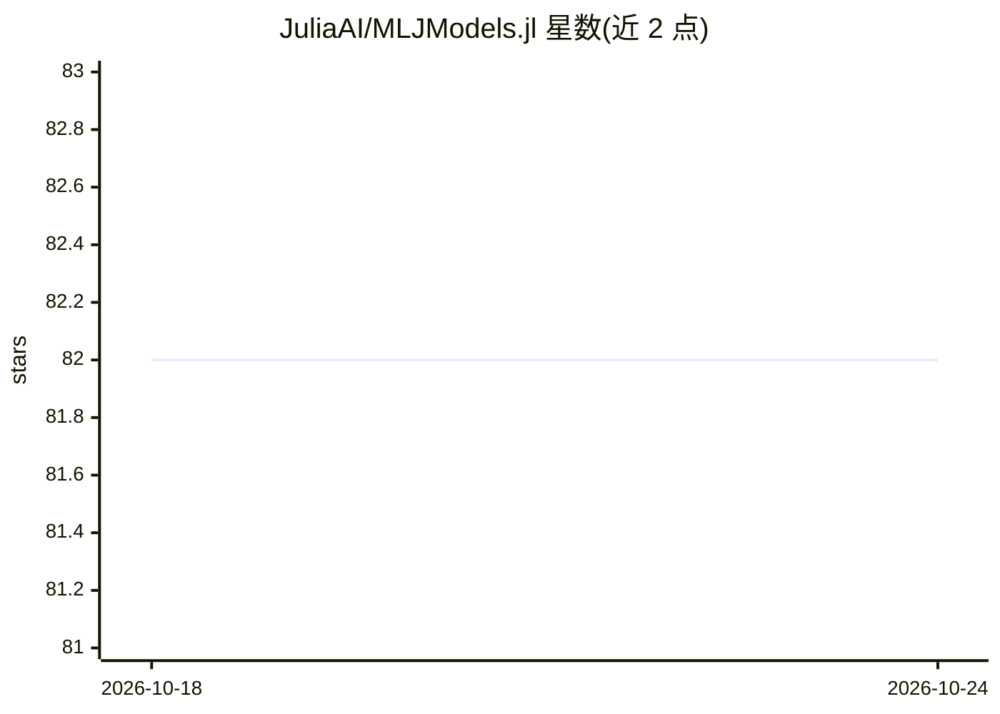

# JuliaAI/MLJModels.jl

⭐ 82 · Julia · MIT · 推送 2026-09-16 · [GitHub](https://github.com/JuliaAI/MLJModels.jl) · 组织维护

**MLJ 模型注册表及模型搜索/加载工具库**

Julia 生态中 MLJ 机器学习框架的模型注册表与配套工具：维护一个收录实现 MLJ 接口的模型包及其元数据的 TOML 数据库，提供 models()、matching() 等搜索查询工具，以及 @load、@iload 宏从 MLJ 内部加载模型代码。仓库面向维护注册表和开发新模型接口的开发者，普通 MLJ 用户无需直接关注（它是 MLJ 的依赖）。注册新模型需向本仓库提交 PR，并另行向 MLJ 提交模型描述符更新。

## 筛选速览

| 维度 | 判定 | 备注 |
|---|---|---|
| AI 角色 | `ai-ecosystem` | LLM/agent 周边工具 |
| 许可风险 | `permissive` | MIT |
| 部署形态 | `None` |  |
| 模型依赖 | — | README 未给出锁定关系 |
| 硬件要求 | — | 无带数字的原话,不猜 |
| 安装摩擦 | `low` | 无编译、无系统依赖或容器化 |
| 成熟度 | — | 结构信号不足 |

## 能力要点

- 维护 MLJ Model Registry（TOML 格式的模型包与元数据数据库）
- 提供 models()/matching() 模型搜索与 @load/@iload 代码加载工具
- 支持原生实现或独立接口包两种模型接入方式

## 适用场景

- 为 MLJ 框架注册新机器学习模型接口
- 查询 MLJ 生态中已注册的模型及元数据
- 通过 @load 在 MLJ 中加载特定模型实现

## 场景标签

 · 领域:机器学习基础设施

## 证据(README 行号)

> L6: Home of the MLJ Model Registry and tools for model search and model code loading.
> L24: - MLJ tools for searching the database (`models(...)` and `matching(...)`) and for loading
> L25:  model code (`@load`, `@iload`).

## 星数曲线

2026-10-18 82 → 2026-10-24 82（+0）

---
*卡片 v1 · prompt 1.4 · 生成 2026-10-24 · 置信度 high · 依据 README sha `d142454bd70e` · [字段定义](../../DATASET.md)*
