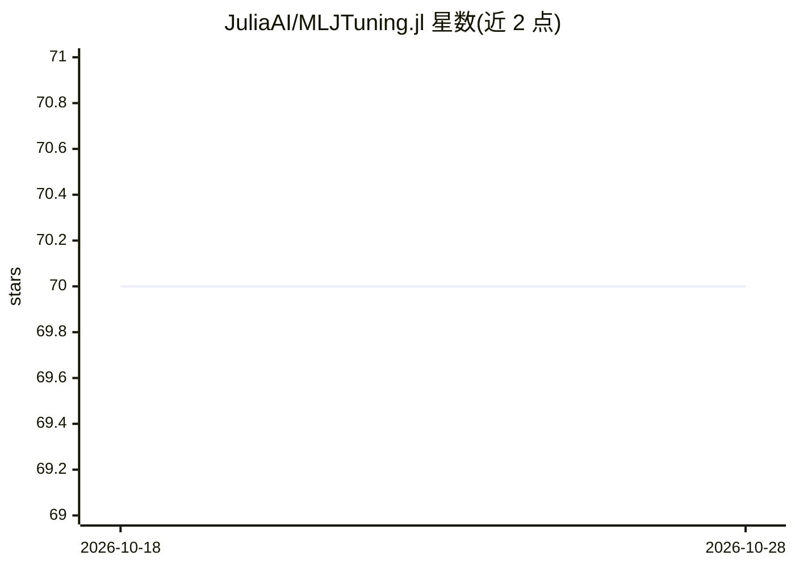

# JuliaAI/MLJTuning.jl

⭐ 70 · Julia · MIT · 推送 2026-10-23 · [GitHub](https://github.com/JuliaAI/MLJTuning.jl) · 组织维护

**MLJ 机器学习框架的超参数优化组件**

MLJTuning 是 Julia MLJ 机器学习平台的超参数优化组件，不面向普通 MLJ 用户直接导入，而是作为 MLJ 的依赖使用。它提供 TunedModel 包装器，将任意 MLJ 模型转为拟合时自动优化指定超参数的自调优模型，内置 Grid、RandomSearch、LatinHypercube、Explicit 等策略，并定义调优策略接口供开发者接入新算法（如粒子群、树 Parzen 估计器通过第三方包实现）。调优以批量迭代方式评估模型，支持并行加速。限制：贝叶斯优化、多目标优化、遗传算法等策略尚未实现。

## 筛选速览

| 维度 | 判定 | 备注 |
|---|---|---|
| AI 角色 | `ai-ecosystem` | LLM/agent 周边工具 |
| 许可风险 | `permissive` | MIT |
| 部署形态 | `None` |  |
| 模型依赖 | — | README 未给出锁定关系 |
| 硬件要求 | — | 无带数字的原话,不猜 |
| 安装摩擦 | `low` | 无编译、无系统依赖或容器化 |
| 成熟度 | — | 结构信号不足 |

## 能力要点

- TunedModel 包装器将任意 MLJ 模型转为自调优模型
- 内置 Grid、RandomSearch、LatinHypercube、Explicit 调优策略
- 定义抽象调优策略接口供第三方包接入新算法
- 支持 CPUProcesses/CPUThreads 并行加速调优与重采样

## 适用场景

- 我在 MLJ 中训练模型时自动搜索最优超参数
- 我想把自己的优化算法接入 MLJ 调优框架
- 我需要通过交叉验证评估候选超参数组合

## 场景标签

`MLOps` · 领域:训练与推理

## 证据(README 行号)

> L3: Hyperparameter optimization for
> L16: This repository is not intended to be directly imported by the general
> L22: MLJTuning is the place for developers to integrate hyperparameter

## 星数曲线

2026-10-18 70 → 2026-10-28 70（+0）

---
*卡片 v1 · prompt 1.4 · 生成 2026-10-24 · 置信度 high · 依据 README sha `9fc564b6d8a5` · [字段定义](../../DATASET.md)*
