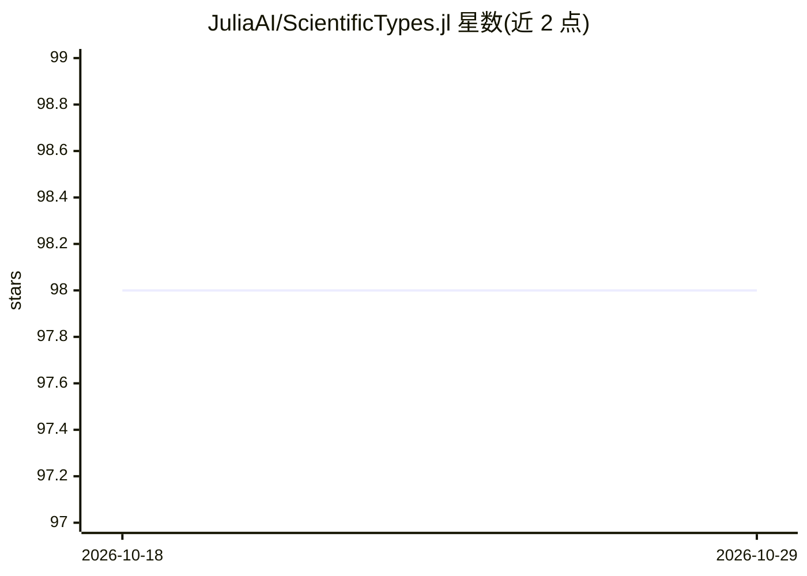

# JuliaAI/ScientificTypes.jl

⭐ 98 · Julia · MIT · 推送 2026-09-28 · [GitHub](https://github.com/JuliaAI/ScientificTypes.jl) · 组织维护

**Julia 数据科学类型约定库：按数据用途而非机器类型分派**

Julia 包，区分机器类型与科学类型：机器类型指 Julia 底层数据类型（如 Float64），科学类型指数据的解释方式（如 Continuous、Multiclass）。包重导出 ScientificTypesBase.jl 的科学类型与方法，提供默认约定的 scitype 定义、按指定科学解释转换机器类型的 coerce 函数，以及推测科学类型的 autotype 函数。面向希望以通用、面向目的的方式声明数据类型要求的统计与科学软件开发者；约定最初为 MLJ 生态开发。通过 Julia Pkg 安装。

## 筛选速览

| 维度 | 判定 | 备注 |
|---|---|---|
| AI 角色 | `ai-ecosystem` | LLM/agent 周边工具 |
| 许可风险 | `permissive` | MIT |
| 部署形态 | `None` |  |
| 模型依赖 | — | README 未给出锁定关系 |
| 硬件要求 | — | 无带数字的原话,不猜 |
| 安装摩擦 | `low` | 无编译、无系统依赖或容器化 |
| 成熟度 | — | 结构信号不足 |

## 能力要点

- 区分机器类型与科学类型并按科学类型分派
- coerce 函数将机器类型转换为指定科学解释
- autotype 函数推测数据的科学类型

## 适用场景

- 统计软件开发者以通用方式声明数据类型要求
- 在 MLJ 生态中统一数据解释约定
- 数据预处理时按科学类型转换列类型

## 场景标签

 · 领域:机器学习基础设施/数据类型

## 证据(README 行号)

> L7: This package makes a distinction between **machine type** and
> L29: - developers of statistical and scientific software who want to
> L38: The module `ScientificTypes` defined in this repo rexports the

## 星数曲线

2026-10-18 98 → 2026-10-29 98（+0）

---
*卡片 v1 · prompt 1.4 · 生成 2026-10-23 · 置信度 high · 依据 README sha `e642f5c91850` · [字段定义](../../DATASET.md)*
