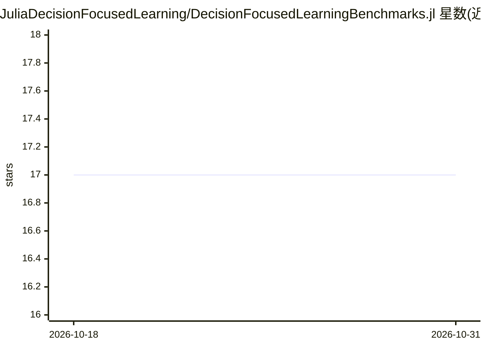

# JuliaDecisionFocusedLearning/DecisionFocusedLearningBenchmarks.jl

⭐ 17 · Julia · MIT · 推送 2026-10-19 · [GitHub](https://github.com/JuliaDecisionFocusedLearning/DecisionFocusedLearningBenchmarks.jl) · 组织维护

**面向决策聚焦学习算法评测的 Julia 基准问题集**

提供一组用于评估 Decision-Focused Learning（决策聚焦学习）算法的基准问题，覆盖静态、随机与动态场景。每个基准包含数据集生成器、统计模型架构与组合优化 oracle，可接入任意 DFL 训练算法。通过 Julia 的 Pkg 安装，属 JuliaDecisionFocusedLearning 组织生态，与 InferOpt.jl 等包兼容。包声明处于活跃开发期，API 可能变更。

## 筛选速览

| 维度 | 判定 | 备注 |
|---|---|---|
| AI 角色 | `ai-ecosystem` | LLM/agent 周边工具 |
| 许可风险 | `permissive` | MIT |
| 部署形态 | `None` |  |
| 模型依赖 | — | README 未给出锁定关系 |
| 硬件要求 | — | 无带数字的原话,不猜 |
| 安装摩擦 | `low` | 无编译、无系统依赖或容器化 |
| 成熟度 | `idea` | |

## 能力要点

- 每个基准提供数据集生成器、统计模型与组合 oracle 三件套
- 覆盖静态、随机、动态三类决策场景
- 统一接口，可插入任意 DFL 训练算法

## 适用场景

- 评测和对比决策聚焦学习算法的表现
- 获取带组合优化 oracle 的标准实验问题
- DFL 算法研究中复现统一基准实验

## 场景标签

`模型评测` · 领域:评测与运维

## 证据(README 行号)

> L12: **DecisionFocusedLearningBenchmarks.jl** provides a collection of benchmark problems for evaluating Decision-Focuse
> L13: Each benchmark provides a dataset generator, a statistical model architecture, and a combinatorial oracle, ready to

## 星数曲线

2026-10-18 17 → 2026-10-31 17（+0）

---
*卡片 v1 · prompt 1.4 · 生成 2026-10-30 · 置信度 high · 依据 README sha `f469e12a2d71` · [字段定义](../../DATASET.md)*
