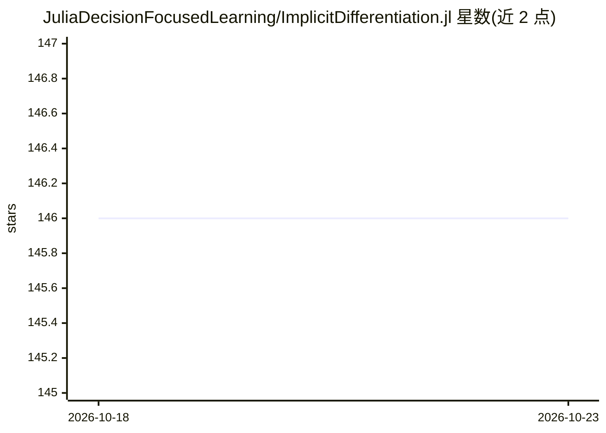

# JuliaDecisionFocusedLearning/ImplicitDifferentiation.jl

⭐ 146 · Julia · MIT · 推送 2026-10-02 · [GitHub](https://github.com/JuliaDecisionFocusedLearning/ImplicitDifferentiation.jl) · [官网](https://juliadecisionfocusedlearning.github.io/ImplicitDifferentiation.jl/) · 组织维护

**Julia 库：对隐函数定义的映射做自动微分**

Julia 包，为隐式定义的前向映射 y(x)（由条件 c(x,y(x))=0 确定）提供自动微分能力。适用于两类场景：直接自动微分失败的情形（如外部求解器调用、可变操作、类型限制）和微分过慢的情形（如不动点方程或优化算法等迭代过程）。理论基于 Blondel 等人 2022 年论文《Efficient and modular implicit differentiation》。通过 Julia 的 Pkg 安装，面向 Julia 科学计算与机器学习生态（SciML 相关）的用户。

## 筛选速览

| 维度 | 判定 | 备注 |
|---|---|---|
| AI 角色 | `ai-ecosystem` | LLM/agent 周边工具 |
| 许可风险 | `permissive` | MIT |
| 部署形态 | `None` |  |
| 模型依赖 | — | README 未给出锁定关系 |
| 硬件要求 | — | 无带数字的原话,不猜 |
| 安装摩擦 | `low` | 无编译、无系统依赖或容器化 |
| 成熟度 | — | 结构信号不足 |

## 能力要点

- 对隐式条件 c(x,y(x))=0 定义的映射求导
- 解决外部求解器、可变操作导致 AD 失败的场景
- 加速不动点方程、优化算法等迭代过程的微分
- 基于 Blondel et al. (2022) 论文的模块化隐式微分

## 适用场景

- 在 Julia 中对调用外部求解器的函数做微分
- 对不动点迭代或优化算法内部过程进行高效求导
- 构建可微分的科学计算/优化流程

## 场景标签

 · 领域:科学计算/自动微分

## 证据(README 行号)

> L10: ImplicitDifferentiation.jl is a package for automatic differentiation of functions defined implicitly, i.e., _forwa
> L26: - Those for which automatic differentiation fails. Reasons can vary depending on your backend, but the most common 

## 星数曲线

2026-10-18 146 → 2026-10-23 146（+0）

---
*卡片 v1 · prompt 1.4 · 生成 2026-10-22 · 置信度 high · 依据 README sha `ac3d2ad10f07` · [字段定义](../../DATASET.md)*
