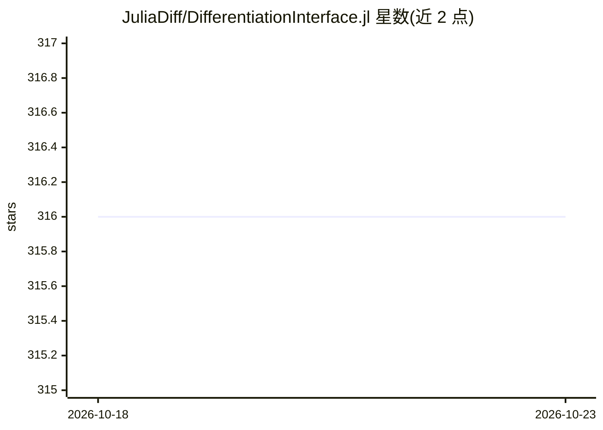

# JuliaDiff/DifferentiationInterface.jl

⭐ 316 · Julia · MIT · 推送 2026-10-19 · [GitHub](https://github.com/JuliaDiff/DifferentiationInterface.jl) · [官网](https://juliadiff.org/DifferentiationInterface.jl/DifferentiationInterface) · 组织维护

**Julia 多后端自动微分的统一接口库**

为 Julia 生态提供统一的微分语法抽象层：定义一阶与二阶算子（梯度、Jacobi 矩阵、Hessian 等）、原地/非原地微分、准备机制（预分配缓存或记录 tape）、内建稀疏处理，并配套 DifferentiationInterfaceTest 测试与基准工具。支持 ADTypes.jl 定义的约 15 个后端（Enzyme、ForwardDiff、Zygote、Mooncake 等），其中 Diffractor 标注为当前损坏。README 提示经由此接口在部分场景（尤其 Enzyme）可能比直接调用后端 API 更慢或更易出错。通过 Julia Pkg 安装，附 JMLR 论文引用信息。

## 筛选速览

| 维度 | 判定 | 备注 |
|---|---|---|
| AI 角色 | `ai-ecosystem` | LLM/agent 周边工具 |
| 许可风险 | `permissive` | MIT |
| 部署形态 | `None` |  |
| 模型依赖 | — | README 未给出锁定关系 |
| 硬件要求 | — | 无带数字的原话,不猜 |
| 安装摩擦 | `low` | 无编译、无系统依赖或容器化 |
| 成熟度 | — | 结构信号不足 |

## 能力要点

- 一阶/二阶算子统一语法（梯度、Jacobians、Hessians 等）
- 支持 ADTypes.jl 定义的约 15 个 AD 后端
- 准备机制（预分配缓存/记录 tape）与内建稀疏处理
- 配套 DifferentiationInterfaceTest 测试与基准工具

## 适用场景

- Julia 项目中编写与具体 AD 后端无关的微分代码
- 需要切换或比较多个 AD 后端时减少改造成本
- 科学计算与机器学习库复用统一微分入口

## 场景标签

 · 领域:科学计算/自动微分

## 证据(README 行号)

> L14: An interface to various automatic differentiation (AD) backends in Julia.
> L29: We support the following backends defined by ADTypes.jl:

## 星数曲线

2026-10-18 316 → 2026-10-23 316（+0）

---
*卡片 v1 · prompt 1.4 · 生成 2026-10-21 · 置信度 high · 依据 README sha `504b71222500` · [字段定义](../../DATASET.md)*
