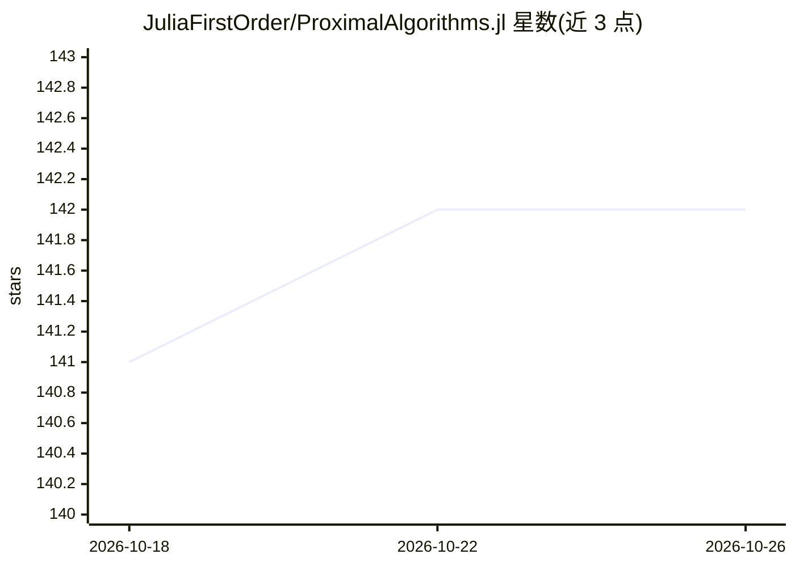

# JuliaFirstOrder/ProximalAlgorithms.jl

⭐ 142 · Julia · NOASSERTION · 推送 2026-10-18 · [GitHub](https://github.com/JuliaFirstOrder/ProximalAlgorithms.jl) · 组织维护

**Julia 非光滑优化算法库：近端梯度、ADMM 等分裂法**

Julia 语言的开源数值优化包，提供针对含非光滑项目标函数（约束、不可微罚项）的极小化算法，包括（快速）近端梯度法、Douglas-Rachford 分裂、三项分裂、原始-对偶分裂算法与牛顿类方法。微分依赖 DifferentiationInterface.jl（也可自带梯度），非光滑项通过 ProximalCore API 的近端映射与投影处理，可搭配 ProximalOperators 函数集。面向科研与工程优化问题的开发者，含稳定版与开发版文档，并请求研究使用时引用相关文献。

## 筛选速览

| 维度 | 判定 | 备注 |
|---|---|---|
| AI 角色 | `ai-ecosystem` | LLM/agent 周边工具 |
| 许可风险 | `none` | NOASSERTION |
| 部署形态 | `None` |  |
| 模型依赖 | — | README 未给出锁定关系 |
| 硬件要求 | — | 无带数字的原话,不猜 |
| 安装摩擦 | `low` | 无编译、无系统依赖或容器化 |
| 成熟度 | — | 结构信号不足 |

## 能力要点

- 实现（快速）近端梯度、Douglas-Rachford、三项分裂、原始-对偶分裂与牛顿类方法
- 通过 ProximalCore API 统一处理近端映射与投影
- 自动微分依赖 DifferentiationInterface.jl，支持自带梯度

## 适用场景

- 求解含约束或 L1 罚项等非光滑项的优化问题
- 构建分布式优化（ADMM/分裂法）求解流程
- 学术研究中复现与引用近端算法

## 场景标签

`科研工具` · 领域:学习与行业

## 证据(README 行号)

> L6: A Julia package for non-smooth optimization algorithms.
> L8: This package provides algorithms for the minimization of objective functions
> L10: Implemented algorithms include:

## 星数曲线

2026-10-18 141 → 2026-10-26 142（+1）

---
*卡片 v1 · prompt 1.4 · 生成 2026-10-23 · 置信度 mid · 依据 README sha `02d2679b2e8a` · [字段定义](../../DATASET.md)*
