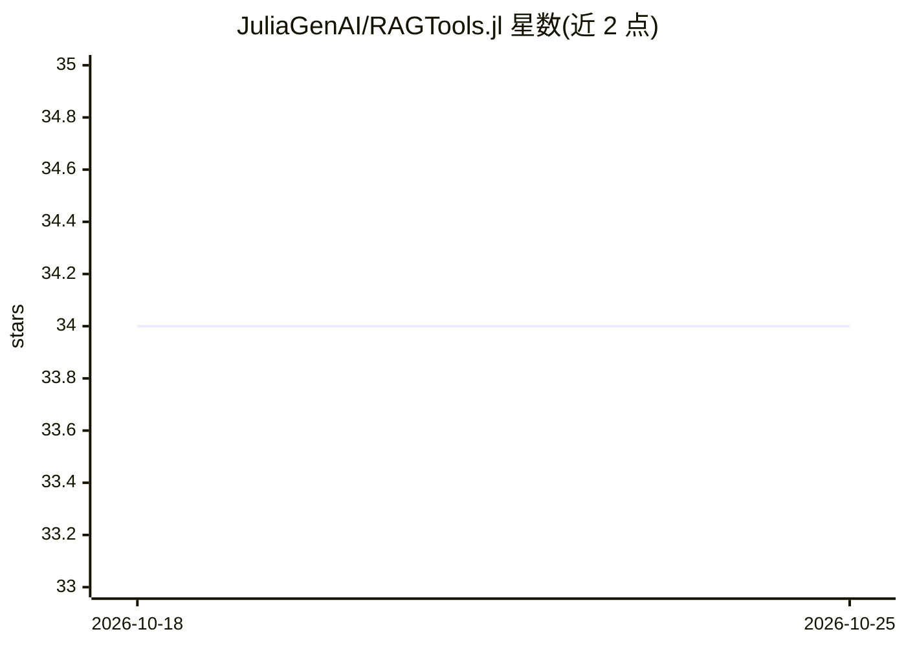

# JuliaGenAI/RAGTools.jl

⭐ 34 · Julia · MIT · 推送 2025-11-27 · [GitHub](https://github.com/JuliaGenAI/RAGTools.jl) · [官网](http://juliagenai.github.io/RAGTools.jl/) · 组织维护

**面向 Julia 开发者的内存 RAG 管线构建工具包**

Julia 语言的 RAG 应用构建包，从 PromptingTools.jl 独立拆分而来。核心函数包括 build_index（从文档建索引）、airag（检索+生成一体）、retrieve、generate!、annotate_support 与 build_qa_evals。定位为高性能内存 RAG 管线，避免云托管向量数据库；如需向量库支持可通过重载管线函数接入。通过 PromptingTools.jl 支持多种 AI 模型与提供方。检索侧提供余弦相似度、BM25、二值/位压缩嵌入与混合索引，重排支持 FlashRank.jl、RankGPT 与 Cohere Rerank API；并带答案来源支持度分析、彩色/HTML 引用标注、QA 评测对生成、成本追踪等。

## 筛选速览

| 维度 | 判定 | 备注 |
|---|---|---|
| AI 角色 | `ai-ecosystem` | LLM/agent 周边工具 |
| 许可风险 | `permissive` | MIT |
| 部署形态 | `None` |  |
| 模型依赖 | — | README 未给出锁定关系 |
| 硬件要求 | — | 无带数字的原话,不猜 |
| 安装摩擦 | `low` | 无编译、无系统依赖或容器化 |
| 成熟度 | — | 结构信号不足 |

## 能力要点

- build_index/airag 一行式 RAG 与模块化可扩展管线
- 内存 RAG 管线，避免云托管向量数据库，可重载函数接入向量库
- 多种检索方式：稠密余弦、BM25、二值/位压缩嵌入、混合索引、HYDE 与多查询
- 答案支持度标注（彩色终端/HTML 输出）与 QA 评测对生成、成本追踪

## 适用场景

- 在 Julia 中快速搭建从原型到生产级 RAG 应用
- 对生成答案做来源引用与支持度可视化核验
- 生成 QA 对并评测 RAG 管线质量

## 场景标签

`RAG` · 领域:知识与检索

## 证据(README 行号)

> L5: RAGTools.jl is a battle-tested package for building Retrieval-Augmented Generation (RAG) applications in Julia. Orig
> L7: The package focuses on high-performance, in-memory RAG pipelines that leverage Julia's speed to avoid the complexity
> L18: - `airag`: Generate answers using RAG (combines `retrieve` and `generate!`)

## 星数曲线

2026-10-18 34 → 2026-10-25 34（+0）

---
*卡片 v1 · prompt 1.4 · 生成 2026-10-25 · 置信度 high · 依据 README sha `b14981ecc8c8` · [字段定义](../../DATASET.md)*
