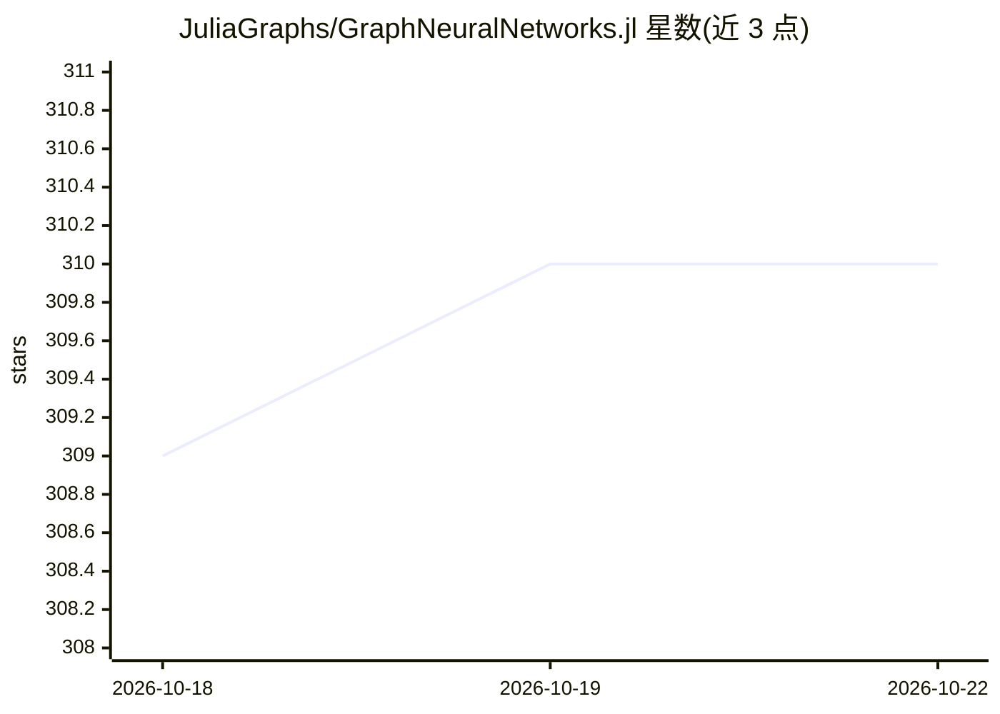

# JuliaGraphs/GraphNeuralNetworks.jl

⭐ 310 · Julia · MIT · 推送 2026-10-11 · [GitHub](https://github.com/JuliaGraphs/GraphNeuralNetworks.jl) · [官网](https://juliagraphs.org/GraphNeuralNetworks.jl) · 组织维护

**Julia 图神经网络库：提供图卷积层与消息传递框架**

面向 Julia 开发者的图深度学习库集合，含四个包：GraphNeuralNetworks.jl（Flux 前端）、GNNLux.jl（Lux 前端）、GNNGraphs.jl（图数据结构）、GNNlib.jl（基于 gather/scatter 或稀疏矩阵乘法的消息传递框架实现）。支持常见图卷积层、批量图计算、自定义层、CUDA 与 AMDGPU、Graphs.jl 集成及异构与动态图。通过 Julia 包管理器安装，前端包自动再导出底层包。

## 筛选速览

| 维度 | 判定 | 备注 |
|---|---|---|
| AI 角色 | `ai-ecosystem` | LLM/agent 周边工具 |
| 许可风险 | `permissive` | MIT |
| 部署形态 | `None` |  |
| 模型依赖 | — | README 未给出锁定关系 |
| 硬件要求 | — | 无带数字的原话,不猜 |
| 安装摩擦 | `medium` | 含编译或系统依赖之一 |
| 成熟度 | — | 结构信号不足 |

## 能力要点

- 基于 gather/scatter 或稀疏矩阵乘法的消息传递框架
- 支持 CUDA 与 AMDGPU 计算
- 支持异构图与动态图卷积
- 提供 Flux.jl 与 Lux.jl 两种后端前端包

## 适用场景

- 在 Julia 中搭建图神经网络模型
- 做节点、边、图级别的机器学习任务
- 在 GPU 上训练图深度学习模型

## 场景标签

`模型训练` · 领域:训练与推理

## 证据(README 行号)

> L5: **Libraries for deep learning on graphs in Julia**, using either Flux.jl or Lux.jl as backend frameworks.
> L9: - **GraphNeuralNetworks.jl**: Provides graph convolutional layers based on the deep learning framework Flux.jl. This
> L21: - Implementation of common graph convolutional layers.

## 星数曲线

2026-10-18 309 → 2026-10-22 310（+1）

---
*卡片 v1 · prompt 1.4 · 生成 2026-10-21 · 置信度 high · 依据 README sha `66942460ae05` · [字段定义](../../DATASET.md)*
