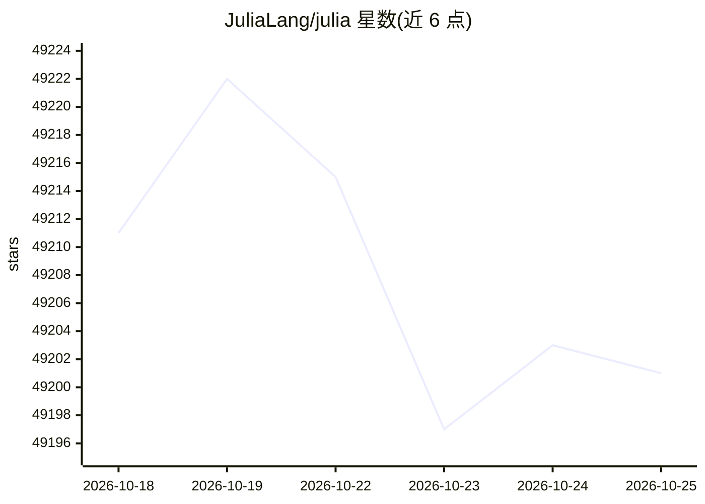

# JuliaLang/julia

⭐ 49,201 · Julia · MIT · 推送 2026-10-24 · [GitHub](https://github.com/JuliaLang/julia) · [官网](https://julialang.org/) · 组织维护

**面向技术计算的高性能动态编程语言**

Julia 是一种面向技术计算的高级动态编程语言，官方仓库提供源代码、编译与安装说明。安装推荐使用 juliaup 管理多版本，也可手动下载二进制或从源码 git clone 后用 make 编译，编译需约 2GiB 磁盘与 4GiB 虚拟内存。README 还涵盖源码目录结构、REPL 使用、以及 Emacs/Vim/VS Code/Jupyter/Pluto 等编辑与笔记本环境支持。

## 筛选速览

| 维度 | 判定 | 备注 |
|---|---|---|
| AI 角色 | `ai-ecosystem` | LLM/agent 周边工具 |
| 许可风险 | `permissive` | MIT |
| 部署形态 | `None` |  |
| 模型依赖 | — | README 未给出锁定关系 |
| 硬件要求 | — | 无带数字的原话,不猜 |
| 安装摩擦 | `low` | 无编译、无系统依赖或容器化 |
| 成熟度 | — | 结构信号不足 |

## 动量与使用信号

- 维护:`active` — 距上次 push 0.7 天,年发版 21,388 位贡献者
- 涨星:近 1 天 **+4**(自 20261016 起算)

## 能力要点

- 面向技术计算的高级动态语言
- juliaup 安装管理器支持多版本共存与更新
- 支持从源码 make 编译构建
- 提供 REPL 及多种编辑器/IDE/笔记本支持

## 适用场景

- 科学与数值计算开发
- 高性能计算场景下的编程
- 机器学习相关开发
- 通过 IJulia/Pluto 做交互式笔记本计算

## 场景标签

 · 领域:编程语言/科学计算

## 证据(README 行号)

> L17: Julia is a high-level, high-performance dynamic language for technical
> L52: The recommended way of installing Julia is to use `juliaup` which will install
> L88: To build the `julia` executable, run `make` from within the julia directory.

## 星数曲线

2026-10-18 49,211 → 2026-10-25 49,201（-10）

---
*卡片 v1 · prompt 1.4 · 生成 2026-10-18 · 置信度 high · 依据 README sha `4e8bcabaa968` · [字段定义](../../DATASET.md)*
