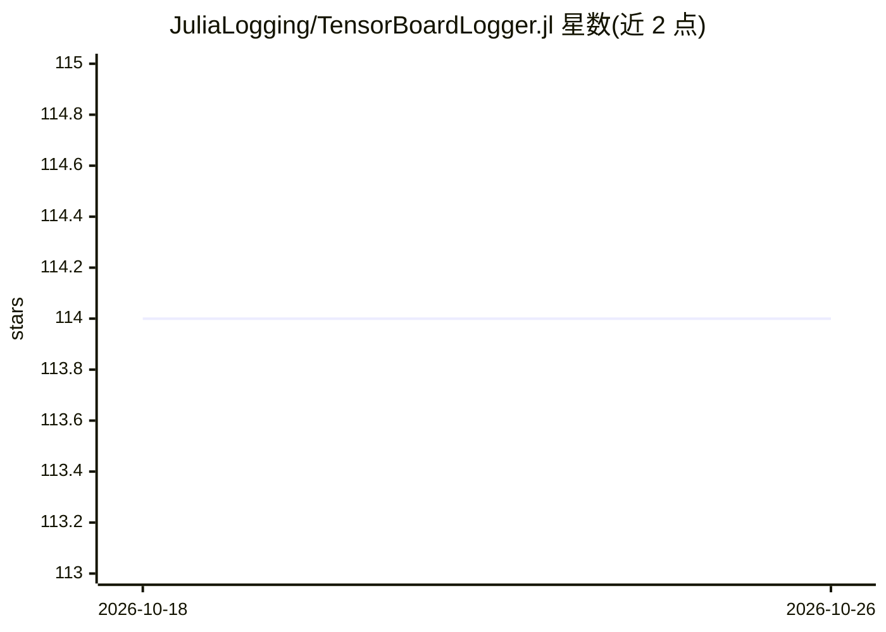

# JuliaLogging/TensorBoardLogger.jl

⭐ 114 · Julia · MIT · 推送 2026-09-25 · [GitHub](https://github.com/JuliaLogging/TensorBoardLogger.jl) · 组织维护

**Julia 标准日志框架的 TensorBoard 日志库**

TensorBoardLogger.jl 是 Julia 原生库，扩展 Julia 标准 Logging 框架，将任意类型数据写入 TensorBoard：数值记为标量、数组分箱为直方图，支持图像、音频及 Plots/PyPlot/Gadfly 图形的原生记录。核心类型 TBLogger 可用 global_logger 设为全局或 with_logger 限定作用域，并可经 LoggingExtras.jl 与其他日志后端组合。另可反序列化 TensorBoard 的 .proto 文件。基于 ProtoBuf.jl，通过 Julia REPL 包管理安装；记录图像需额外安装 ImageMagick（macOS 还需 QuartzImageIO）。

## 筛选速览

| 维度 | 判定 | 备注 |
|---|---|---|
| AI 角色 | `ai-ecosystem` | LLM/agent 周边工具 |
| 许可风险 | `permissive` | MIT |
| 部署形态 | `None` |  |
| 模型依赖 | — | README 未给出锁定关系 |
| 硬件要求 | — | 无带数字的原话,不猜 |
| 安装摩擦 | `low` | 无编译、无系统依赖或容器化 |
| 成熟度 | — | 结构信号不足 |

## 能力要点

- 扩展 Julia 标准 Logging 框架，TBLogger 与 ConsoleLogger 同接口
- 任意类型可记录：标量/直方图/图像/音频/Plots 等图形
- 支持反序列化 TensorBoard .proto 文件
- 可经 LoggingExtras.jl 与其他日志后端同时输出

## 适用场景

- 在 Julia 训练/计算流程中把指标与图形写入 TensorBoard 可视化
- 将 TensorBoard 日志与控制台等其他后端并行记录
- 解析已有的 TensorBoard .proto 文件

## 场景标签

`MLOps` · 领域:训练与推理

## 证据(README 行号)

> L4: **TensorBoardLogger.jl** is a native library for logging arbitrary data to
> L5: Tensorboard, extending Julia's standard Logging framework.

## 星数曲线

2026-10-18 114 → 2026-10-26 114（+0）

---
*卡片 v1 · prompt 1.4 · 生成 2026-10-23 · 置信度 high · 依据 README sha `918337e3d9b9` · [字段定义](../../DATASET.md)*
