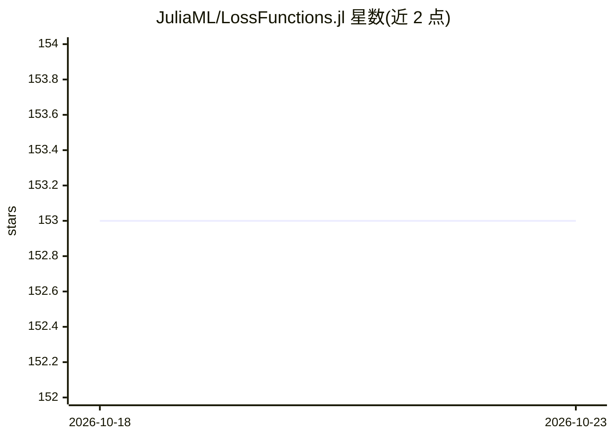

# JuliaML/LossFunctions.jl

⭐ 153 · Julia · NOASSERTION · 推送 2026-09-27 · [GitHub](https://github.com/JuliaML/LossFunctions.jl) · [官网](https://juliaml.github.io/LossFunctions.jl/stable) · 组织维护

**Julia 机器学习损失函数库：提供常用监督损失的实现**

Julia 生态的损失函数包，实现机器学习中常用的监督损失（如 HingeLoss 系列 MarginLoss 等），并提供查询损失性质的 API（如凸性），支持计算单观测及任意大小数组的损失值、一阶与二阶导数，可配置逐元素结果的求和或平均方式。面向使用 Julia 进行机器学习模型训练的开发者，通过 Julia 包管理器安装，MIT 许可。

## 筛选速览

| 维度 | 判定 | 备注 |
|---|---|---|
| AI 角色 | `ai-ecosystem` | LLM/agent 周边工具 |
| 许可风险 | `none` | NOASSERTION |
| 部署形态 | `None` |  |
| 模型依赖 | — | README 未给出锁定关系 |
| 硬件要求 | — | 无带数字的原话,不猜 |
| 安装摩擦 | `low` | 无编译、无系统依赖或容器化 |
| 成熟度 | — | 结构信号不足 |

## 能力要点

- 提供多种机器学习常用监督损失函数的实现
- 支持损失值、一阶导数与二阶导数的计算
- 支持单观测与任意大小数组输入，可配置求和或平均
- 提供查询损失性质（如凸性）的 API

## 适用场景

- 在 Julia 中训练分类或回归模型时使用标准损失函数
- 查询损失函数的数学性质（如凸性）
- 对数组形式批量预测计算损失及其导数

## 场景标签

 · 领域:机器学习库

## 证据(README 行号)

> L3: _LossFunctions.jl is a Julia package that provides efficient and
> L4: well-tested implementations for a diverse set of loss functions

## 星数曲线

2026-10-18 153 → 2026-10-23 153（+0）

---
*卡片 v1 · prompt 1.4 · 生成 2026-10-22 · 置信度 high · 依据 README sha `675e94505567` · [字段定义](../../DATASET.md)*
