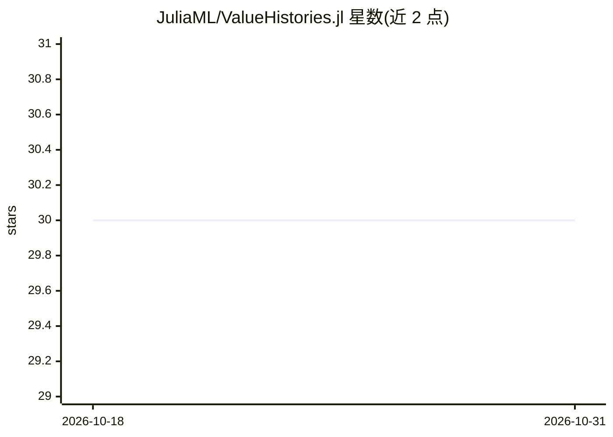

# JuliaML/ValueHistories.jl

⭐ 30 · Julia · NOASSERTION · 推送 2026-02-24 · [GitHub](https://github.com/JuliaML/ValueHistories.jl) · 组织维护

**Julia 优化过程记录库：追踪训练曲线与任意类型数值历史**

Julia 语言的工具包，用于在优化或训练过程中按时间/迭代记录信息，采样点无需等距、仅需严格递增。提供两类数据结构：单值历史（QHistory 用 Dequeue、History 用 Vector 存储）与多值历史（MVHistory，按 symbol key 组织多个不同类型的历史）。支持 push!、get、increment! 等操作，两种实现均为类型稳定。另提供 Plots.jl 绘图配方，仅支持 Real 类型。通过 Julia 包管理器安装，MIT 许可。

## 筛选速览

| 维度 | 判定 | 备注 |
|---|---|---|
| AI 角色 | `ai-ecosystem` | LLM/agent 周边工具 |
| 许可风险 | `none` | NOASSERTION |
| 部署形态 | `None` |  |
| 模型依赖 | — | README 未给出锁定关系 |
| 硬件要求 | — | 无带数字的原话,不猜 |
| 安装摩擦 | `low` | 无编译、无系统依赖或容器化 |
| 成熟度 | — | 结构信号不足 |

## 能力要点

- 单值历史（QHistory/History）与多值历史（MVHistory）两种类型稳定实现
- 支持任意类型值与不等距采样点
- 提供 Plots.jl 可视化配方（仅 Real 类型）

## 适用场景

- 在模型训练中记录损失曲线等单值演化
- 同时追踪多个不同类型的指标并按标签区分
- 训练结束后直接用 Plots.jl 绘制历史曲线

## 场景标签

 · 领域:机器学习工具库

## 证据(README 行号)

> L3: *Utility package for efficient tracking of optimization histories,
> L21: We provide two basic approaches for logging information over time

## 星数曲线

2026-10-18 30 → 2026-10-31 30（+0）

---
*卡片 v1 · prompt 1.4 · 生成 2026-10-26 · 置信度 high · 依据 README sha `245dfe345e07` · [字段定义](../../DATASET.md)*
