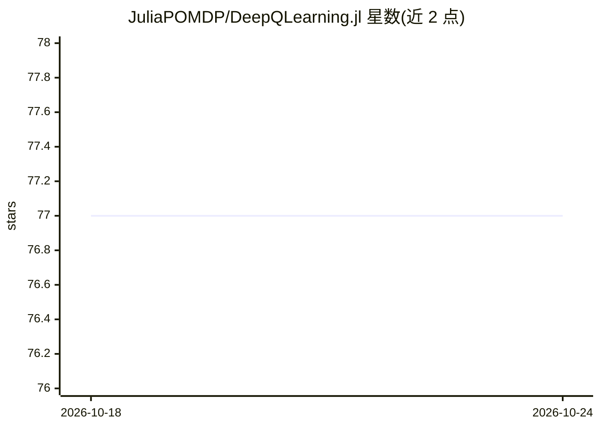

# JuliaPOMDP/DeepQLearning.jl

⭐ 77 · Julia · NOASSERTION · 推送 2025-11-16 · [GitHub](https://github.com/JuliaPOMDP/DeepQLearning.jl) · 组织维护

**Julia 实现的 Deep Q-Learning 算法库，用于求解 MDP**

基于 Julia 的深度强化学习库，实现 Deep Q-Learning 及多种扩展：Target Network、优先经验回放、Dueling、Double Q 与循环 Q 学习（DRQN）。构建于 POMDPs.jl 与 Flux.jl 之上，面向用 Julia 做马尔可夫决策过程求解与强化学习研究的开发者。支持自定义探索/评估策略、任意 Flux Chain 结构的 Q 网络、TensorBoardLogger 日志记录、bson 权重保存；GPU 支持需检出 gpu-support 分支且未充分测试。

## 筛选速览

| 维度 | 判定 | 备注 |
|---|---|---|
| AI 角色 | `ai-native` | 本体是模型或模型工具 |
| 许可风险 | `none` | NOASSERTION |
| 部署形态 | `None` |  |
| 模型依赖 | — | README 未给出锁定关系 |
| 硬件要求 | — | 无带数字的原话,不猜 |
| 安装摩擦 | `low` | 无编译、无系统依赖或容器化 |
| 成熟度 | — | 结构信号不足 |

## 能力要点

- 实现 Double Q、Dueling、优先经验回放、循环 Q 学习等扩展
- 基于 POMDPs.jl 与 Flux.jl，支持任意 Chain 结构 Q 网络
- 可自定义探索与评估策略函数
- 通过 CuArrays.jl 提供 GPU 支持（gpu-support 分支，未充分测试）

## 适用场景

- 在 Julia 中用 DQN 及其变体求解 MDP 问题
- 复现深度强化学习算法实验并记录 TensorBoard 日志
- 接入 POMDPs.jl 生态做强化学习研究

## 场景标签

`强化学习` · 领域:训练与推理

## 证据(README 行号)

> L6: This package provides an implementation of the Deep Q learning algorithm for solving MDPs. For more information see 
> L7: It uses POMDPs.jl and Flux.jl

## 星数曲线

2026-10-18 77 → 2026-10-24 77（+0）

---
*卡片 v1 · prompt 1.4 · 生成 2026-10-24 · 置信度 high · 依据 README sha `775f6e42d7ff` · [字段定义](../../DATASET.md)*
