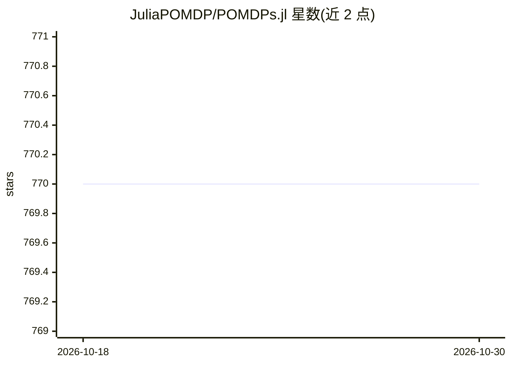

# JuliaPOMDP/POMDPs.jl

⭐ 770 · Julia · NOASSERTION · 推送 2026-10-25 · [GitHub](https://github.com/JuliaPOMDP/POMDPs.jl) · [官网](http://juliapomdp.github.io/POMDPs.jl/latest/) · 组织维护

**Julia 的 MDP/POMDP 定义、求解与仿真接口框架**

提供用 Julia 表达马尔可夫决策过程（MDP）与部分可观测马尔可夫决策过程（POMDP）的核心接口，配套 POMDPTools 作为标准库（策略、信念更新器、分布、仿真器）。生态含 QMDP、SARSOP、MCTS、ARDESPOT 等求解器，支持离散与连续空间、在线/离线求解；可通过 quickpomdps/pyjulia 从 Python 使用，并与 JuliaReinforcementLearning 包双向集成。求解器列表附星级主观成熟度评级；部分求解器（带*）需要非 Julia 依赖。

## 筛选速览

| 维度 | 判定 | 备注 |
|---|---|---|
| AI 角色 | `ai-ecosystem` | LLM/agent 周边工具 |
| 许可风险 | `none` | NOASSERTION |
| 部署形态 | `None` |  |
| 模型依赖 | — | README 未给出锁定关系 |
| 硬件要求 | — | 无带数字的原话,不猜 |
| 安装摩擦 | `low` | 无编译、无系统依赖或容器化 |
| 成熟度 | — | 结构信号不足 |

## 能力要点

- MDP/POMDP 统一接口，支持离散与连续空间
- 配套 POMDPTools 标准库与数十个求解器包（MCTS、SARSOP、ARDESPOT 等）
- 通过 quickpomdps/pyjulia 支持 Python 定义与求解
- 提供求解器成熟度星级评级与性能基准列表

## 适用场景

- 在 Julia 中形式化定义顺序决策问题并调用求解器
- 做 POMDP 求解算法研究与对比实验
- 从 Python 侧访问 POMDPs.jl 生态

## 场景标签

`强化学习` · 领域:训练与推理

## 证据(README 行号)

> L12: This package provides a core interface for working with Markov decision processes (MDPs) and partially observable M
> L15: Our goal is to provide a common programming vocabulary for:
> L18: 2. Writing solver software.

## 星数曲线

2026-10-18 770 → 2026-10-30 770（+0）

---
*卡片 v1 · prompt 1.4 · 生成 2026-10-21 · 置信度 high · 依据 README sha `e063df9691fa` · [字段定义](../../DATASET.md)*
