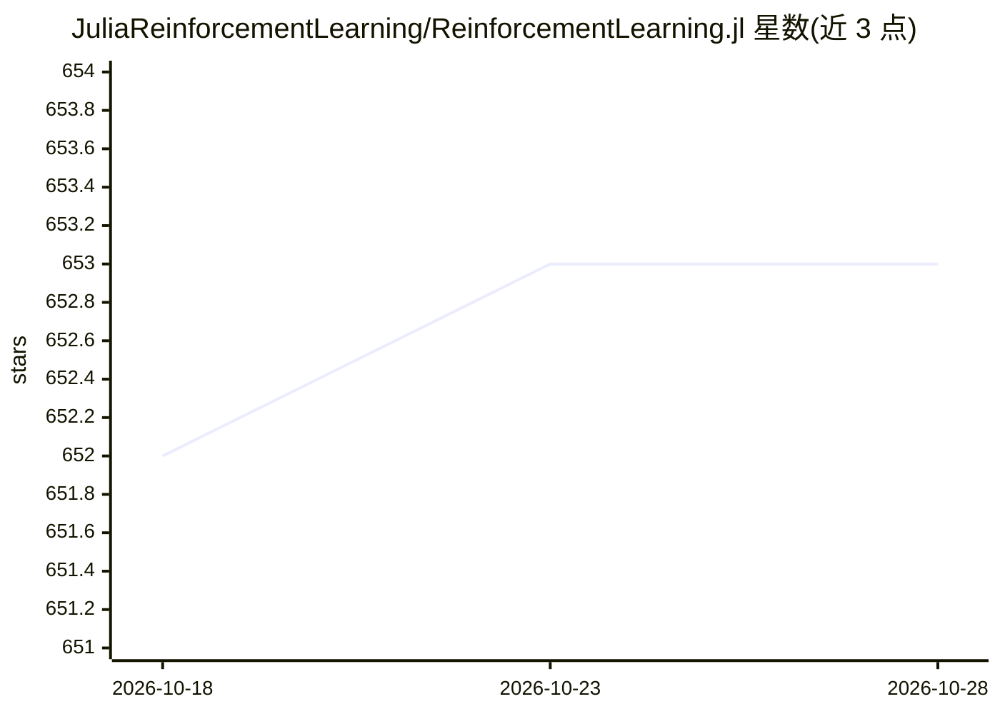

# JuliaReinforcementLearning/ReinforcementLearning.jl

⭐ 653 · Julia · NOASSERTION · 推送 2026-10-08 · [GitHub](https://github.com/JuliaReinforcementLearning/ReinforcementLearning.jl) · [官网](https://juliareinforcementlearning.org) · 组织维护

**Julia 语言的强化学习研究包**

面向 Julia 生态的强化学习研究框架，本身是多个子包（Base/Environments/Core/Zoo/Distributed 等）的封装层。设计原则包括组件复用与可扩展、便于运行基准实验与对比评估算法、以及从表格方法到深度强化学习的可复现性。核心抽象为 Policy、Environment、Stop Condition、Hook 四类组件，可组装成实验。纯 Julia 编写，MIT 许可，提供教程与博客说明设计细节，引用格式见 CITATION.bib。

## 筛选速览

| 维度 | 判定 | 备注 |
|---|---|---|
| AI 角色 | `ai-native` | 本体是模型或模型工具 |
| 许可风险 | `none` | NOASSERTION |
| 部署形态 | `None` |  |
| 模型依赖 | — | README 未给出锁定关系 |
| 硬件要求 | — | 无带数字的原话,不猜 |
| 安装摩擦 | `low` | 无编译、无系统依赖或容器化 |
| 成熟度 | — | 结构信号不足 |

## 能力要点

- 封装多个子包（Base/Core/Zoo/Environments/Distributed/Experiments 等）的统一框架
- Policy/Environment/StopCondition/Hook 四组件实验抽象
- 内置随机策略、CartPole 等环境与逐回合奖励等 Hook 示例
- 纯 Julia 编写，MIT 许可，支持引用（CITATION.bib）

## 适用场景

- 在 Julia 中实现和对比强化学习算法
- 运行基准实验并诊断评估 agent
- 基于可复用组件快速搭建新算法实验

## 场景标签

`强化学习` · 领域:训练与推理

## 证据(README 行号)

> L3: **ReinforcementLearning.jl**,
> L4: as the name says, is a package for reinforcement learning research in Julia.
> L70: `ReinforcementLearning.jl` itself is just a wrapper around several other

## 星数曲线

2026-10-18 652 → 2026-10-28 653（+1）

---
*卡片 v1 · prompt 1.4 · 生成 2026-10-21 · 置信度 high · 依据 README sha `6ade4d98edb9` · [字段定义](../../DATASET.md)*
