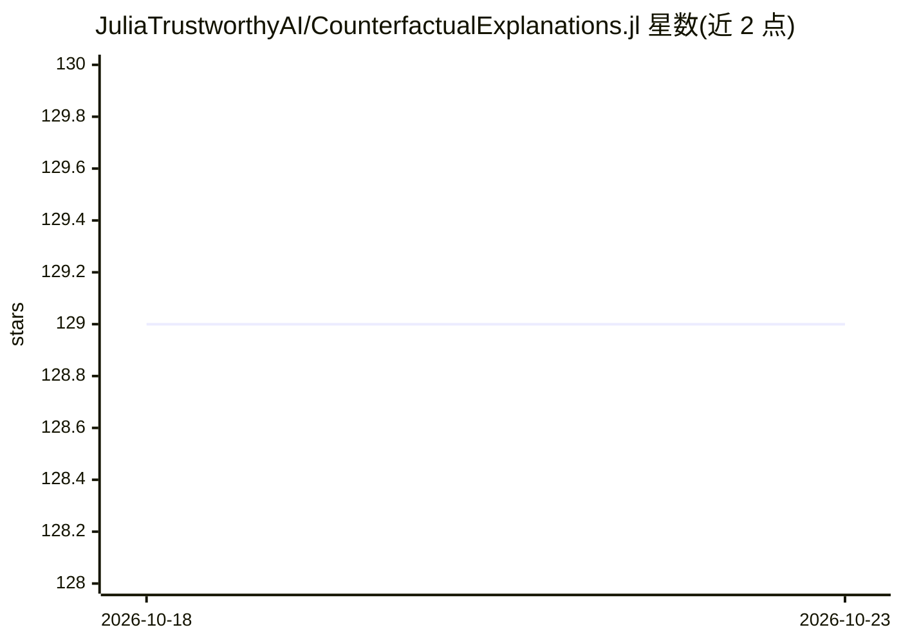

# JuliaTrustworthyAI/CounterfactualExplanations.jl

⭐ 129 · Julia · MIT · 推送 2026-08-12 · [GitHub](https://github.com/JuliaTrustworthyAI/CounterfactualExplanations.jl) · [官网](https://www.taija.org/CounterfactualExplanations.jl/) · 组织维护

**Julia 反事实解释与算法追索库：解释黑盒模型决策**

用纯 Julia 编写的可解释 AI（XAI）软件包，为黑盒机器学习模型生成反事实解释（CE）与算法追索（AR），说明输入需如何改变才能得到不同决策结果。实现 13 种生成器（Wachter、DiCE、 ClaPRO、MINT 因果 CE、T-CREx 全局 CE 等），生成器可组合；也可解释在 Python、R 等语言中训练的模型。通过 Julia General Registry 安装，附 JuliaCon 论文。当前不支持回归模型、MLJ.jl 全模型支持为规划目标。

## 筛选速览

| 维度 | 判定 | 备注 |
|---|---|---|
| AI 角色 | `ai-ecosystem` | LLM/agent 周边工具 |
| 许可风险 | `permissive` | MIT |
| 部署形态 | `None` |  |
| 模型依赖 | — | README 未给出锁定关系 |
| 硬件要求 | — | 无带数字的原话,不猜 |
| 安装摩擦 | `low` | 无编译、无系统依赖或容器化 |
| 成熟度 | — | 结构信号不足 |

## 能力要点

- 实现 13 种反事实生成器（含因果 CE 与全局 CE）
- 自 v0.1.9 起生成器完全可组合
- 可用于解释 Python/R 等语言训练的模型
- 自带 Give Me Some Credit 等示例数据集与用例

## 适用场景

- 为被拒贷等黑盒决策生成可操作的输入修改建议
- 对分类模型（如 MNIST 图像分类器）做反事实解释
- 可信机器学习研究中对比多种 CE 生成方法

## 场景标签

`科研工具` · 领域:学习与行业

## 证据(README 行号)

> L7: `CounterfactualExplanations.jl` is a package for generating Counterfactual Explanations (CE) and Algorithmic Recours
> L147: The goal of this library is to contribute to efforts towards trustworthy machine learning in Julia. The Julia lang

## 星数曲线

2026-10-18 129 → 2026-10-23 129（+0）

---
*卡片 v1 · prompt 1.4 · 生成 2026-10-22 · 置信度 high · 依据 README sha `00760d50c8e8` · [字段定义](../../DATASET.md)*
