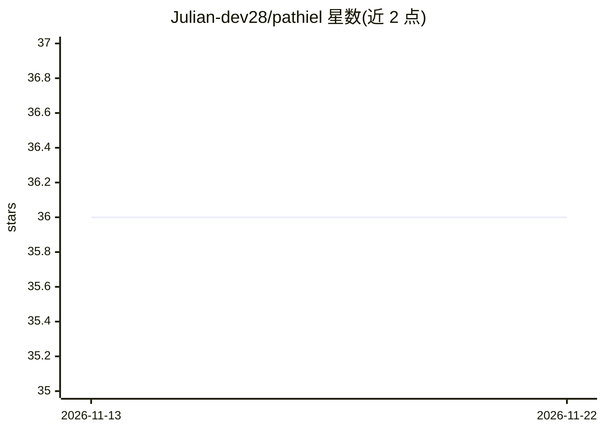

# Julian-dev28/pathiel

⭐ 36 · Python · MIT · 推送 2026-11-21 · [GitHub](https://github.com/Julian-dev28/pathiel) · [官网](https://julian-dev28.github.io/pathiel/) · 个人维护

**让 Claude 在 Hyperliquid 交易永续合约的 MCP 服务器插件**

免费开源的 Hyperliquid MCP 服务器与 Claude Code 插件：提供 30 个工具，从 Claude Code、Claude Desktop、Cursor 或任意 MCP 客户端读取 Hyperliquid 永续合约行情与账户并下单。每笔交易为带止损和止盈目标的括号单，默认风险配置 3 倍杠杆、每笔权益 1%。提供原油（布伦特/WTI）与金属（金/银）交易台简报。无密钥时只读；公开安装默认运行于主网、涉及真实资金，可用环境变量切换至测试网。安装需 Claude Code 与 Python 3.11+。

## 筛选速览

| 维度 | 判定 | 备注 |
|---|---|---|
| AI 角色 | `ai-ecosystem` | LLM/agent 周边工具 |
| 许可风险 | `permissive` | MIT |
| 部署形态 | `self-host` | docker 或自建部署 |
| 模型依赖 | locked-api |  |
| 硬件要求 | — | 无带数字的原话,不猜 |
| 安装摩擦 | `low` | 无编译、无系统依赖或容器化 |
| 成熟度 | — | 结构信号不足 |

## 能力要点

- 30 个 MCP 工具覆盖行情、账户、风控、下单与交易台
- 每单必带止损与止盈的括号单结构，默认 3x / 1% 风险配置
- 无密钥只读模式，测试网一键切换
- 原油与金属交易台简报（EIA、FRED、CFTC 等公开数据源）

## 适用场景

- 在 Claude Code 中用自然语言查询 Hyperliquid 行情与持仓
- 通过对话让 Claude 按固定风险规则下括号单交易永续合约
- 先用测试网或 dry-run 模式练习下单流程

## 场景标签

`金融量化` · 领域:学习与行业

## 证据(README 行号)

> L21: pathiel is a free, open-source Hyperliquid MCP server and Claude Code plugin: 30 tools that read Hyperliquid perpet
> L10: MCP server

## 星数曲线

2026-11-13 36 → 2026-11-22 36（+0）

---
*卡片 v1 · prompt 1.4 · 生成 2026-11-18 · 置信度 high · 依据 README sha `78dc729428b6` · [字段定义](../../DATASET.md)*
