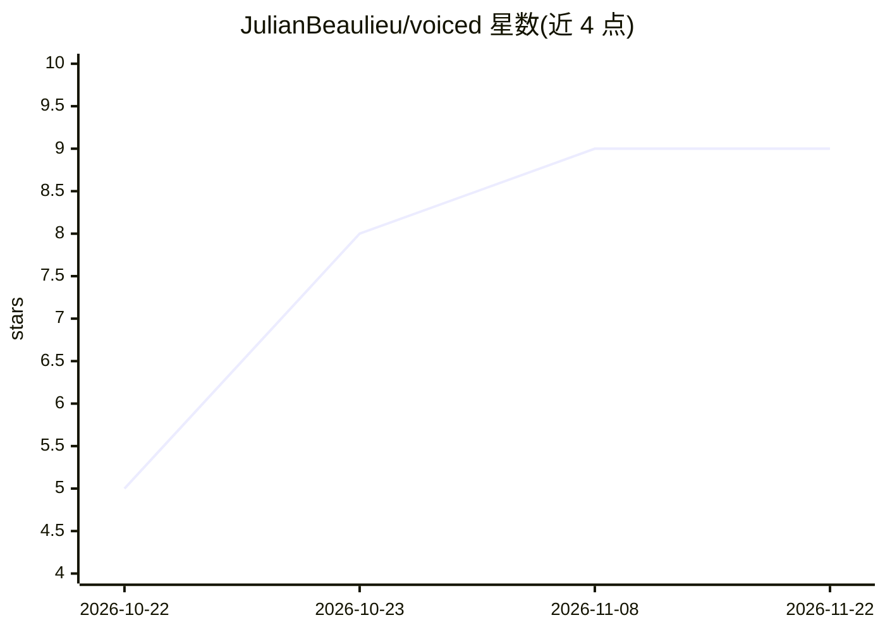

# JulianBeaulieu/voiced

⭐ 9 · Python · MIT · 推送 2026-11-14 · [GitHub](https://github.com/JulianBeaulieu/voiced) · 个人维护

**Apple Silicon Mac 上的本地语音识别与合成服务器**

在 Mac 本地运行语音转文字（STT）与文字转语音（TTS）两组服务，默认分别使用 Parakeet TDT 0.6B v3 与 Kokoro-82M 模型，常驻 Apple Silicon GPU。对外提供 OpenAI 音频 API 与 Wyoming 协议两种接口，可与 Home Assistant Assist 及任何 OpenAI 音频 API 客户端配合。以 launchd LaunchAgents 形式常驻用户登录会话，带看门狗自重启、菜单栏管理应用、空闲卸载模型等内存管理选项，通过 Homebrew 或 DMG 安装。

## 筛选速览

| 维度 | 判定 | 备注 |
|---|---|---|
| AI 角色 | `ai-native` | 本体是模型或模型工具 |
| 许可风险 | `permissive` | MIT |
| 部署形态 | `desktop` | 安装包/桌面程序 |
| 模型依赖 | — | README 未给出锁定关系 |
| 硬件要求 | — | 无带数字的原话,不猜 |
| 安装摩擦 | `medium` | 含编译或系统依赖之一 |
| 成熟度 | — | 结构信号不足 |

## 能力要点

- 提供 OpenAI 兼容音频 API 与 Wyoming 协议，支持流式转录与多格式合成输出
- 默认模型 Parakeet TDT 0.6B v3（STT）与 Kokoro-82M（TTS），另可下载 Qwen3-ASR、Whisper large-v3-turbo 等多个模型
- 以 launchd 服务常驻，崩溃/卡死后自动重启，菜单栏应用管理与自更新
- 空闲卸载设置可将模型占内存从 1.5 GB 降至约 0.12 GB

## 适用场景

- 为 Home Assistant 语音助手提供本地语音识别与合成服务
- 让使用 OpenAI 音频 API 的应用改连本地模型
- 无头 Mac 上以命令行方式运行本地语音服务

## 场景标签

`语音合成` `语音识别` · 领域:内容生成

## 证据(README 行号)

> L7: Run speech-to-text and text-to-speech on your Mac for Home Assistant voice
> L8: control or any app that speaks the OpenAI audio API. Models stay loaded on
> L160: |`POST /v1/audio/transcriptions`|stt|8881|Transcribe a file (json, text, verbose_json, srt, vtt)|

## 星数曲线

2026-10-22 5 → 2026-11-22 9（+4）

---
*卡片 v1 · prompt 1.4 · 生成 2026-11-20 · 置信度 mid · 依据 README sha `8407e76a37d9` · [字段定义](../../DATASET.md)*
