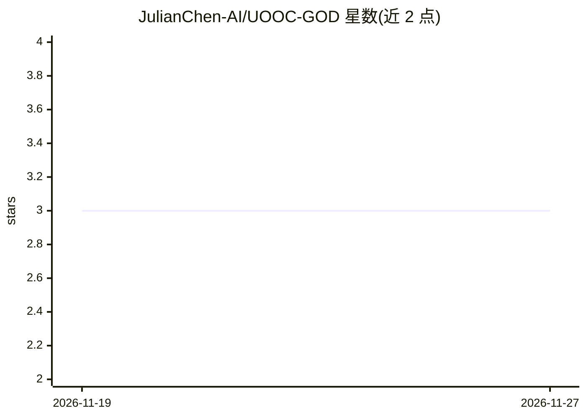

# JulianChen-AI/UOOC-GOD

⭐ 3 · HTML · MIT · 推送 2026-10-27 · [GitHub](https://github.com/JulianChen-AI/UOOC-GOD) · [官网](https://julianchen-ai.github.io/UOOC-GOD/) · 个人维护 · 中文 README

**深大学生的 UOOC 课程自动学习控制台，AI 自动答题**

基于 Node.js 与原生 HTML/CSS/JS 的本地网页控制台，为 YusongXiao/fuckuooc 的 Playwright 自动化引擎提供操作入口：读取账号已有课程并按名称勾选、设置 1-3 门并行运行、配置兼容模型接口（地址/模型名/API Key）、启停任务并查看日志。课程学习与答题能力来自原版引擎，控制台本身不实现自动化；需单独安装指定 commit 版本的引擎、Node.js 24 与 Chrome。考试阶段课程暂不支持勾选启动，未提供保持视频位置的暂停功能。

## 筛选速览

| 维度 | 判定 | 备注 |
|---|---|---|
| AI 角色 | `ai-native` | 本体是模型或模型工具 |
| 许可风险 | `permissive` | MIT |
| 部署形态 | `None` |  |
| 模型依赖 | — | README 未给出锁定关系 |
| 硬件要求 | — | 无带数字的原话,不猜 |
| 安装摩擦 | `low` | 无编译、无系统依赖或容器化 |
| 成熟度 | `idea` | |

## 能力要点

- 按名称读取并多选课程，支持 1-3 门并行与排队
- 兼容接口配置模型，API Key 仅对本次任务生效
- 本地网页控制台（默认 127.0.0.1:4319）查看登录、课程处理与错误日志
- 账号、密钥与学习记录保留在本地

## 适用场景

- 为 UOOC 平台课程批量运行视频学习任务
- 接入自己的模型接口让 AI 自动作答课程题目
- 需要图形界面管理多门课程并行刷课的深大学生

## 场景标签

`浏览器自动化` · 领域:效率与自动化

## 证据(README 行号)

> L9: 深大人自己的 UOOC 刷课神器。按课程名勾选，三门同时开跑，AI 自动答题。把刷课交给它，把时间留给自己。
> L13: 基于 Node.js 与原生 HTML/CSS/JavaScript，调用 YusongXiao/fuckuooc 的 Playwright 自动化引擎。
> L67: 前端使用原生 HTML/CSS/JavaScript；服务端使用 Node.js 内置 HTTP 模块。课程学习与答题能力来自原版引擎，控制台负责操作入口与运行管理。账号、密钥和学习记录保留在本地。

## 星数曲线

2026-11-19 3 → 2026-11-27 3（+0）

---
*卡片 v1 · prompt 1.4 · 生成 2026-11-22 · 置信度 high · 依据 README sha `fa8d534b6dce` · [字段定义](../../DATASET.md)*
