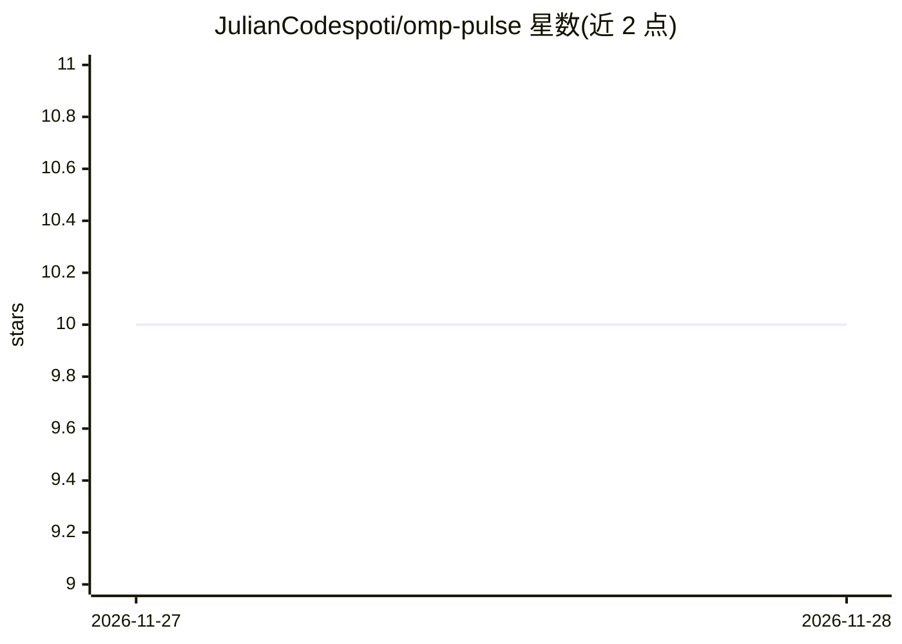

# JulianCodespoti/omp-pulse

⭐ 10 · JavaScript · MIT · 推送 2026-11-26 · [GitHub](https://github.com/JulianCodespoti/omp-pulse) · [官网](https://juliancodespoti.github.io/omp-pulse/) · 个人维护

**远程操控 omp AI 编码代理的手机端/PWA 客户端**

面向 omp（Oh My Pi）编码代理的移动伴侣应用：桌面模式下在 Mac/Windows/Linux 运行一个小程序与 omp 并行，通过 Android APK 或 iPhone PWA 实时查看代理的文件读写与测试执行、一键回答代理提问、审查变更并在终端执行命令；另支持 Android 手机独立运行 omp（proot 环境，非安全沙箱）。提供会话按项目分组与搜索、插件扩展、语音听写（本地转写）、模型中途切换，支持 herdr/kitty/tmux 会话自动接入（Mac/Linux）。MIT 许可，与 omp 无官方关联。

## 筛选速览

| 维度 | 判定 | 备注 |
|---|---|---|
| AI 角色 | `ai-ecosystem` | LLM/agent 周边工具 |
| 许可风险 | `permissive` | MIT |
| 部署形态 | `library` | 以包/库形式分发 |
| 模型依赖 | — | README 未给出锁定关系 |
| 硬件要求 | — | 无带数字的原话,不猜 |
| 安装摩擦 | `medium` | 含编译或系统依赖之一 |
| 成熟度 | — | 结构信号不足 |

## 能力要点

- 实时展示代理的文件读取、改动与测试运行，支持中途介入或停止
- 无 Pulse 账号与中间服务器，代理直连用户已有的模型提供方
- Android 手机模式可在无电脑情况下运行 omp（proot，非沙箱）
- 插件系统可自定义按钮/状态芯片/卡片，需用户批准后才运行

## 适用场景

- 离开工位时跟进长时间运行的编码任务并回答代理提问
- 在手机上审查代理改动后再合入
- 只用 Android 手机完成克隆、测试、修复的编码流程
- 用语音口述消息驱动编码代理

## 场景标签

`编码 Agent` · 领域:编码与开发

## 证据(README 行号)

> L5:  Your AI coding agent, in your pocket. Follow, answer and steer omp (Oh My Pi) from Android or iPhone, or run it nat
> L46: The same app either way. There is no Pulse account and no Pulse server in the middle: your code stays on your hardw
> L105: Pulse is one small program that runs next to omp on your computer, plus the app on your phone. The program keeps y

## 星数曲线

2026-11-27 10 → 2026-11-28 10（+0）

---
*卡片 v1 · prompt 1.4 · 生成 2026-11-27 · 置信度 mid · 依据 README sha `c0261fd04a3d` · [字段定义](../../DATASET.md)*
