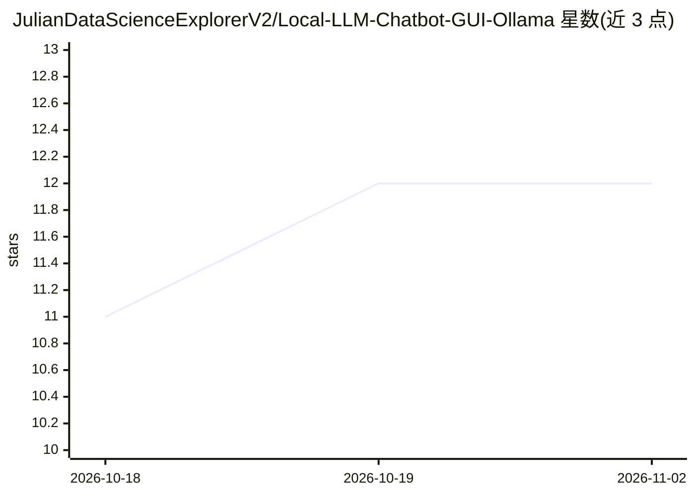

# JulianDataScienceExplorerV2/Local-LLM-Chatbot-GUI-Ollama

⭐ 12 · Python · 推送 2026-02-27 · [GitHub](https://github.com/JulianDataScienceExplorerV2/Local-LLM-Chatbot-GUI-Ollama) · 个人维护

**本地离线 LLM 聊天的 Python 桌面 GUI，基于 Ollama**

用 Tkinter 编写的桌面聊天界面，通过 requests 连接本地 Ollama 服务，与 LLaMA 3、Mistral、Gemma 等已拉取的开源模型进行完全离线的对话。支持在本地已安装的模型间切换、流式 token 输出，无需 API key 与联网。前置条件为本地安装并运行 Ollama 且至少拉取一个模型；运行方式为 git clone 后执行 python app.py。README 为英文/西班牙语双语，未见打包的安装包。

## 筛选速览

| 维度 | 判定 | 备注 |
|---|---|---|
| AI 角色 | `ai-native` | 本体是模型或模型工具 |
| 许可风险 | `none` | — |
| 部署形态 | `None` |  |
| 模型依赖 | local-ok | 支持本地模型 |
| 硬件要求 | — | 无带数字的原话,不猜 |
| 安装摩擦 | `low` | 无编译、无系统依赖或容器化 |
| 成熟度 | — | 结构信号不足 |

## 能力要点

- 通过 requests 连接 localhost Ollama 监听服务
- 支持切换本地已安装模型（LLaMA 3、Mistral、Gemma 等）
- 流式响应实时输出 token
- 完全本地运行，无需 API key 与联网

## 适用场景

- 在本地硬件上离线与开源 LLM 对话
- 通过图形界面切换不同本地模型进行聊天

## 场景标签

`聊天机器人` · 领域:对话与助手

## 证据(README 行号)

> L3: A beautiful, local-first graphical user interface (GUI) written in Python to chat with state-of-the-art open source 
> L12: - **Model Switching**: Select between LLaMA 3, Mistral, Gemma, or any model installed locally.

## 星数曲线

2026-10-18 11 → 2026-11-02 12（+1）

---
*卡片 v1 · prompt 1.4 · 生成 2026-11-01 · 置信度 high · 依据 README sha `2bbc44378284` · [字段定义](../../DATASET.md)*
