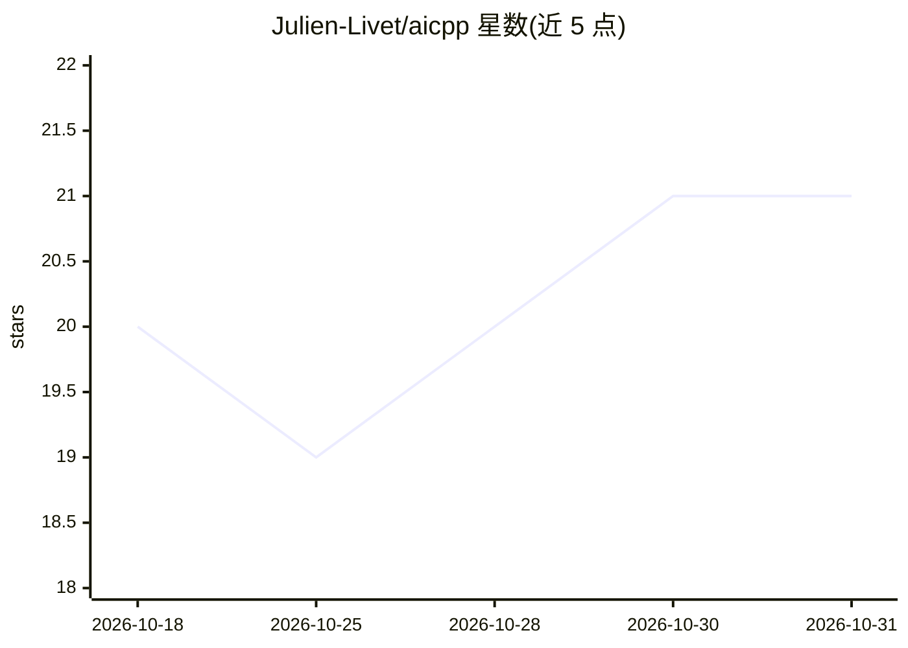

# Julien-Livet/aicpp

⭐ 21 · C++ · Apache-2.0 · 推送 2026-10-25 · [GitHub](https://github.com/Julien-Livet/aicpp) · [官网](https://julien-livet.github.io/aicpp/) · 个人维护

**LLM 引导的确定性符号程序合成引擎，求解 ARC 任务**

C++23 编写的神经符号程序合成引擎：LLM 不直接生成答案，而是分析 ARC 任务示例、选择相关原语并生成结构性部分参数化，以缩减组合搜索空间；随后由编译的确定性 C++ 引擎进行有界深度的穷举搜索，按代价排序组合类型化原语，返回显式符号解（如 flipud(fliplr(input))）。支持动态 C++ 代码生成、结构记忆与 Docker 复现。定位为实验性研究框架，非生产级 ARC 求解器，需 C++23、Python 3.10+ 与 OpenAI API key。

## 筛选速览

| 维度 | 判定 | 备注 |
|---|---|---|
| AI 角色 | `ai-native` | 本体是模型或模型工具 |
| 许可风险 | `permissive` | Apache-2.0 |
| 部署形态 | `None` |  |
| 模型依赖 | — | README 未给出锁定关系 |
| 硬件要求 | — | 无带数字的原话,不猜 |
| 安装摩擦 | `low` | 无编译、无系统依赖或容器化 |
| 成熟度 | `idea` | |

## 能力要点

- LLM 仅作结构性先验，求解阶段为确定性穷举搜索
- 类型化神经元架构与代价排序的组合探索
- 动态 C++ 代码生成与编译、JSON 结构序列化
- 结构记忆与 Docker 复现

## 适用场景

- 在 ARC-AGI 任务上研究 LLM 引导的符号程序合成
- 探索混合符号–LLM 架构的可复现性
- 对程序合成的组合爆炸做结构性缩减实验

## 场景标签

`科研工具` · 领域:学习与行业

## 证据(README 行号)

> L12: **aicpp** is a deterministic symbolic program synthesis engine written in C++, guided by structural reductions gene
> L14: Instead of using LLMs to generate final solutions, aicpp uses them to **reduce the structural search space**, while
> L38: Then a deterministic C++ engine:

## 星数曲线

2026-10-18 20 → 2026-10-31 21（+1）

---
*卡片 v1 · prompt 1.4 · 生成 2026-10-28 · 置信度 high · 依据 README sha `4397954efa07` · [字段定义](../../DATASET.md)*
