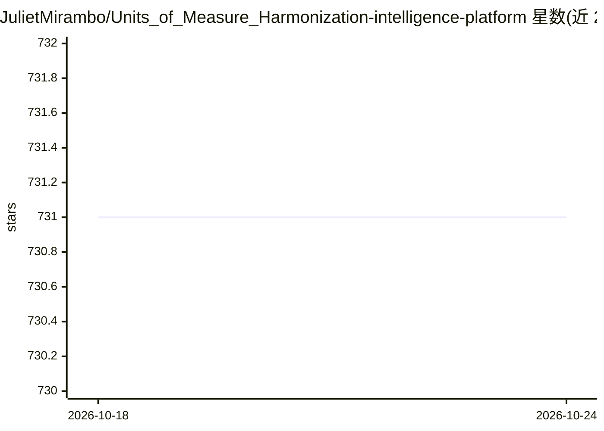

# JulietMirambo/Units_of_Measure_Harmonization-intelligence-platform

⭐ 731 · PowerShell · Apache-2.0 · 推送 2026-05-21 · [GitHub](https://github.com/JulietMirambo/Units_of_Measure_Harmonization-intelligence-platform) · 个人维护

**基于 KNIME 的计量单位错误自动检测 ML 平台**

面向制造、供应链与采购场景的计量单位（UOM）错误检测系统：读取 CSV/Excel 等文件，经 60+ 特征的 XGBoost 分类引擎识别小数错误、单位不匹配、换算与缺失等五类问题，用 NIST 标准换算规则校验，Q-learning 强化学习代理实现自动修正，并在内置交互式仪表盘中展示实时检测、置信度与根因分析。以 KNIME Analytics 4.5+ 工作流形式运行，git clone 后 5 分钟内可启动。README 中 L89 标注 MIT 许可、L173 标注 Apache 2.0，许可声明存在不一致。

## 筛选速览

| 维度 | 判定 | 备注 |
|---|---|---|
| AI 角色 | `ai-native` | 本体是模型或模型工具 |
| 许可风险 | `permissive` | Apache-2.0 |
| 部署形态 | `None` |  |
| 模型依赖 | — | README 未给出锁定关系 |
| 硬件要求 | — | 无带数字的原话,不猜 |
| 安装摩擦 | `low` | 无编译、无系统依赖或容器化 |
| 成熟度 | — | 结构信号不足 |

## 能力要点

- XGBoost 分类引擎（60+ 特征、5 折交叉验证）检测 5 类 UOM 错误
- NIST 标准物理换算校验与 Q-learning 自动修正代理
- 内置于 KNIME 工作流的实时交互式仪表盘
- 支持 CSV/Excel/TSV/管道分隔等多格式输入

## 适用场景

- 清洗制造与采购数据中的计量单位错误
- 迁移遗留系统前统一 SKU 主数据单位
- 核对采购订单与物料清单的单位规格
- 多供应商数据整合前的单位标准化

## 场景标签

`强化学习` · 领域:训练与推理

## 证据(README 行号)

> L53: - **ML Classification Engine** - 60+ features, XGBoost
> L75: - **ML Engine**: 60+ engineered features, XGBoost classifier, 5-fold cross-validation

## 星数曲线

2026-10-18 731 → 2026-10-24 731（+0）

---
*卡片 v1 · prompt 1.4 · 生成 2026-10-21 · 置信度 high · 依据 README sha `1e7069952be6` · [字段定义](../../DATASET.md)*
